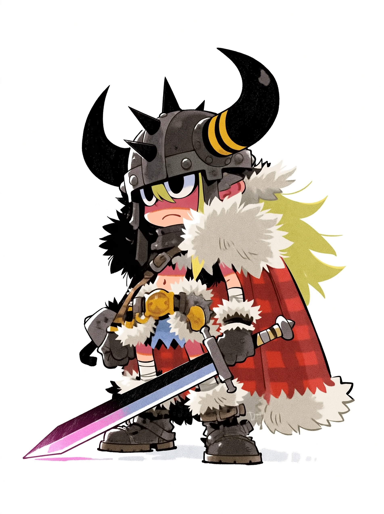

# Niji 8 Q 版全身角色模板：{Character Description} 占位 + 双 sref + profile（纯白底 chibi）

- 原帖链接：https://x.com/imhealmachine/status/2125598597353988238
- 作者：imhealingmachine（@imhealmachine）
- 时间：2026-11-25 22:32 (UTC+8 / Asia/Taipei)
- 互动摘要：点赞 114 · 转发 8 · 回复 1 · 引用 1 · 书签 93 · 浏览 3599（采集快照：2026-11-26 09:30 UTC+8）
- 模型/工具：Midjourney Niji 8（作者标注 Nijijourney）
- 标签：二次元
- 媒体路径：
  - `media/images/2125598597353988238_1.jpg`（）
  - `media/images/2125598597353988238_2.jpg`（）
  - `media/images/2125598597353988238_3.jpg`（）
  - `media/images/2125598597353988238_4.jpg`（）
- 入库日期：2026-11-26
- 备注：prompt 在主帖正文，从「chibi style」起原样摘录到结尾（含 --sref / --profile / --stylize / --hd / --niji 8 参数）；{Character Description} 为占位符。正文为韩文试用感想；帖子引用了另一条帖（2125328040624521639）。示例 4 张 Q 版角色。

## prompt 原文

```text
chibi style, {Character Description}, fullbody, simple white background --ar 3:4 --sref 3092380778 78345491 --profile 43552ok --stylize 1000 --hd --niji 8
```

---

个人学习归档，非商业。prompt 与媒体版权归原作者 @imhealmachine，引用请回到原帖。
