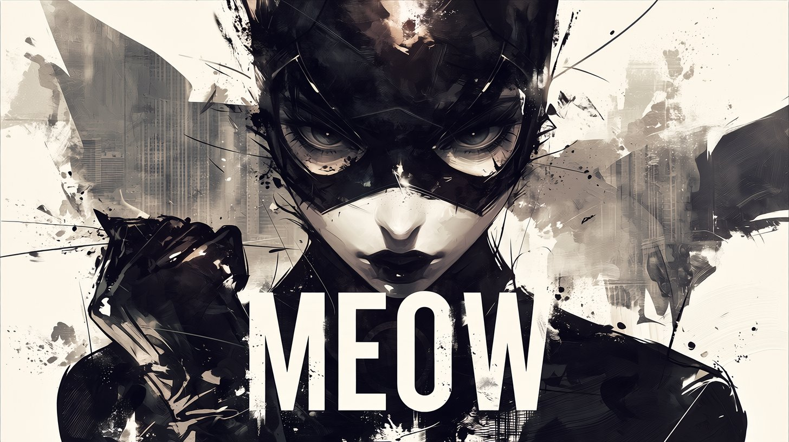

# 「MEOW」猫女海报：Niji 8 下的波普拼贴 + 马赛克多屏幕暗灰调宽幅壁纸

- 原帖链接：https://x.com/Artedeingenio/status/2125613207007981975
- 作者：OscarAI（@Artedeingenio）
- 时间：2026-11-25 23:30 (UTC+8 / Asia/Taipei)
- 互动摘要：点赞 26 · 转发 0 · 回复 1 · 引用 0 · 书签 4 · 浏览 1447（采集快照：2026-11-26 19:55 UTC+8）
- 模型/工具：Midjourney Niji 8（prompt 含 --niji 8）
- 标签：二次元
- 媒体路径：
  - `media/images/2125613207007981975_1.jpg`（）
- 入库日期：2026-11-26
- 备注：prompt 在主帖图片 ALT 里，整段原样摘录。作者称这条 prompt 在 Niji 7 下会崩，Niji 8 下效果很好。猫女为 DC 角色，属同人/二创。

## prompt 原文

```text
HD wallpaper of Catwoman with a title with the capital words "MEOW", in the style of bold and graphic compositions, mosaic-like collages, pop culture mashup, multiple screens, patrice murciano, referential painting, dark and grey, magali villeneuve, macro zoom, outlandish energy, contemporary frescoes, chaotic academia, digital as manual --ar 16:9 --niji 8
```

---

个人学习归档，非商业。prompt 与媒体版权归原作者 @Artedeingenio，引用请回到原帖。
