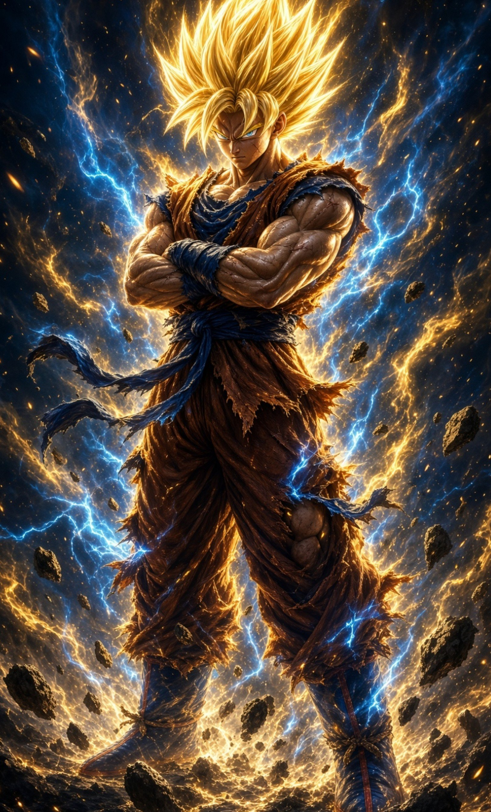
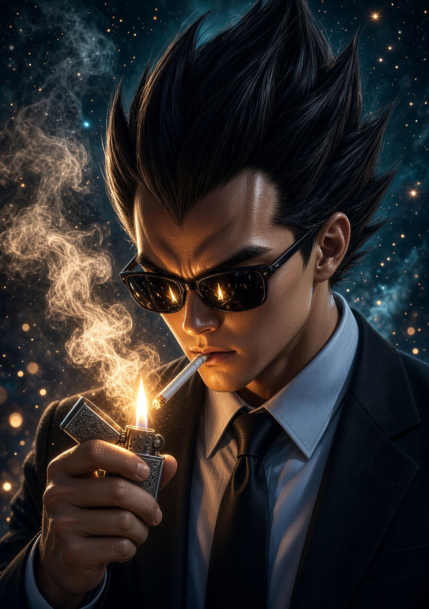

# 「One saves the universe. The other has a meeting at 9.」：西装墨镜叼烟的赛亚人 vs 超级赛亚人金发气场（两条动漫电影感 prompt）

- 原帖链接：https://x.com/Madhuribhai/status/2125628828580200938
- 作者：WeWant Mars（@Madhuribhai）
- 时间：2026-11-26 00:32 (UTC+8 / Asia/Taipei)
- 互动摘要：点赞 26 · 转发 1 · 回复 15 · 引用 0 · 书签 0 · 浏览 346（采集快照：2026-11-26 09:30 UTC+8）
- 模型/工具：GPT Image 2.0（作者标注）
- 标签：二次元
- 媒体路径：
  - `media/images/2125628828580200938_1.jpg`（）
  - `media/images/2125628828580200938_2.jpg`（）
- 入库日期：2026-11-26
- 备注：prompt 在主帖正文（长文），从「Create a highly detailed cinematic anime」起原样摘录到结尾，内含两条 prompt（分别对应图 1 西装赛亚人、图 2 金发超级赛亚人；略去开头「Prompt : []」标签）。为《龙珠》角色同人风格图。

## prompt 原文

```text
Create a highly detailed cinematic anime close-up portrait of a confident, intimidating Saiyan warrior with sharply spiked jet-black hair, wearing sleek black sunglasses, a perfectly tailored black business suit, light blue dress shirt, and black tie.

He casually holds a cigarette between his fingers near his lips, with glowing golden embers and delicate smoke drifting upward. His expression is cold, composed, and effortlessly arrogant. His muscular hand is prominently visible in the foreground.

Use dramatic teal-blue cinematic lighting, subtle golden reflections from the cigarette, atmospheric floating particles, soft background blur, beautifully illustrated facial anatomy, sharp anime-style linework, rich shadows, sophisticated color grading, and a premium hand-painted anime movie aesthetic.

The character should look ridiculously cool without trying. Extremely detailed, 4K, vertical 9:16 portrait.

Create an ultra-detailed, cinematic anime illustration of a legendary muscular martial artist standing confidently in a dark, devastated environment. He has enormous upward-flowing golden Super Saiyan hair, an intense expression, and his arms crossed firmly over his chest. He wears a battle-worn dark blue sleeveless martial arts top, orange waist sash, and dark fighting trousers.

A powerful golden-white energy aura surrounds his entire body, with electric-blue lightning bolts crackling around his arms and legs. Small rocks and debris levitate around him due to the overwhelming energy pressure. His hair glows brilliantly, illuminating his face and upper body against an almost completely black background.

Dramatic low-key lighting, deep shadows, atmospheric smoke, highly detailed muscular anatomy, intricate anime linework, painterly textures, powerful cinematic composition, incredible contrast, dark fantasy atmosphere, 4K quality, vertical 9:16 composition.
```

---

个人学习归档，非商业。prompt 与媒体版权归原作者 @Madhuribhai，引用请回到原帖。
