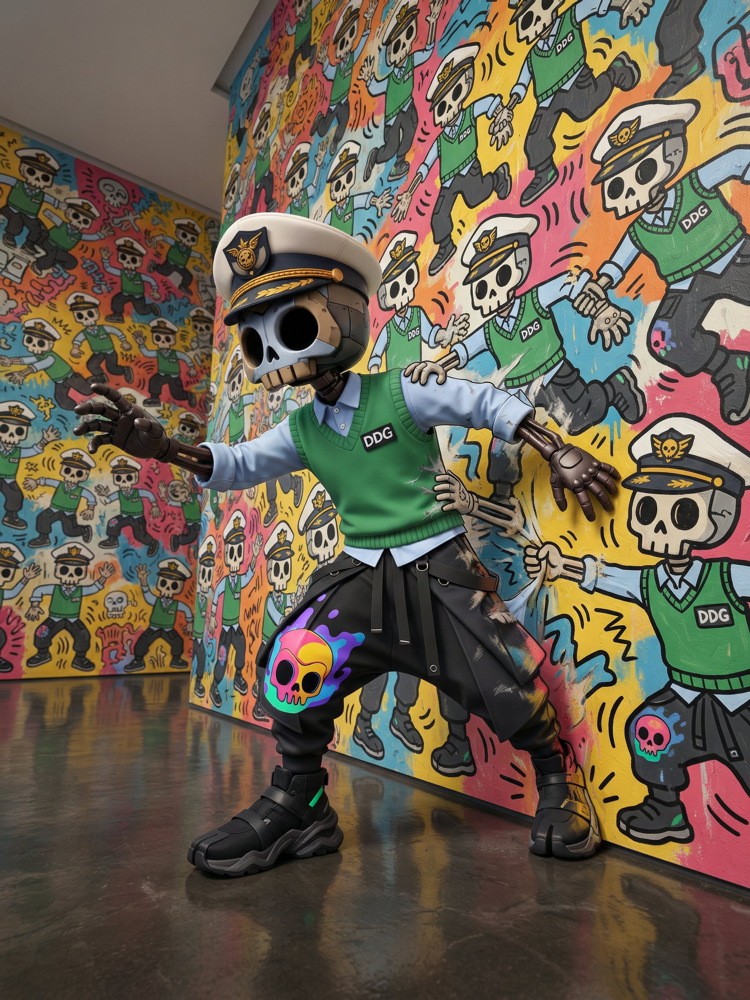

# 被 Keith Haring 风涂鸦墙吞噬：上传角色奋力挣脱、墙上无数 2D 涂鸦分身伸手拉扯（3D→2D 过渡，14mm 超广角）

- 原帖链接：https://x.com/edizkan_/status/2125640268812566868
- 作者：Edizkan ⭕🦇（@edizkan_）
- 时间：2026-11-26 01:18 (UTC+8 / Asia/Taipei)
- 互动摘要：点赞 36 · 转发 7 · 回复 23 · 引用 16 · 书签 5 · 浏览 2888（采集快照：2026-11-26 19:55 UTC+8）
- 模型/工具：未注明
- 标签：其它
- 媒体路径：
  - `media/images/2125640268812566868_1.jpg`（）
- 入库日期：2026-11-26
- 备注：prompt 在主帖正文（长文），从「Create a cinematic surreal scene」起原样摘录到结尾（含末行「ar 3:4」）。需上传角色参考图。正文 @ 了 @DedGorgez，帖子未说明二者关系（是否为 prompt 出处或示例角色作者不详）。

## prompt 原文

```text
Create a cinematic surreal scene of the uploaded reference character desperately resisting being absorbed into colorful doodle-covered walls inspired by Keith Haring’s iconic visual language. Every doodle is a simplified, recognizable illustration of the uploaded character, depicted in different playful, energetic poses using thick black outlines, bold flat colors, rhythmic patterns, and expressive motion marks.

The main character remains three-dimensional, actively struggling to escape as animated doodle versions of itself reach out from the walls and attempt to pull it into their two-dimensional world. Capture a dynamic, asymmetrical resistance pose with visible physical tension. Parts of the character closest to the wall begin transitioning into flat, hand-painted outlines, creating a seamless 3D-to-2D transformation.

Preserve the character’s exact proportions, eye shape, spacing, silhouette, original colors, materials, and defining traits in both the physical character and all doodle variations. Do not humanize or reinterpret anatomy. Do not add a mouth or nose if the original character does not have them.

Extreme wide-angle 14mm lens, ultra-low camera position, slight Dutch tilt, exaggerated architectural perspective. Surrounding mural-covered walls converge dramatically into depth. A highly reflective polished floor mirrors the character and colorful artwork, extending the visual immersion. Directional cinematic lighting, rich saturated primary colors, controlled highlights, realistic contact shadows, and subtle optical depth falloff.

The scene feels playful yet psychologically surreal, a character fighting against becoming its own illustration.

ar 3:4
```

---

个人学习归档，非商业。prompt 与媒体版权归原作者 @edizkan_，引用请回到原帖。
