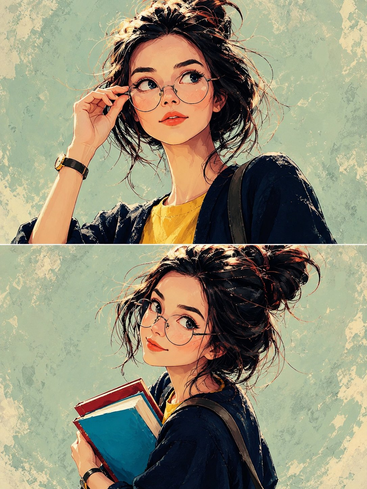

# 「Not every adventure needs a ticket」：圆框眼镜丸子头女子的上下双格手绘动漫编辑插画（JSON 结构化 prompt）

- 原帖链接：https://x.com/Just_Anika_Here/status/2125649082849128934
- 作者：Anika（@Just_Anika_Here）
- 时间：2026-11-26 01:53 (UTC+8 / Asia/Taipei)
- 互动摘要：点赞 52 · 转发 6 · 回复 12 · 引用 0 · 书签 20 · 浏览 1008（采集快照：2026-11-26 09:30 UTC+8）
- 模型/工具：GPT Image 2.5（作者标注）
- 标签：二次元
- 媒体路径：
  - `media/images/2125649082849128934_1.jpg`（）
- 入库日期：2026-11-26
- 备注：prompt 在主帖正文（长文），从「{」起整段 JSON 原样摘录（字符串内的「\n」为原帖字面字符，未改动）。需上传参考图作画风与角色参考；示例为成年女性（prompt 写明 young adult woman），非性化。

## prompt 原文

```text
{
  "aspect_ratio": "3:4",
  "prompt": "Create a beautiful hand-painted anime-inspired editorial illustration using the uploaded reference image as the visual style and character inspiration. The final composition must contain EXACTLY TWO separate horizontal panels stacked vertically, one above the other, within a single 3:4 portrait canvas. Both panels must have equal height and full width, separated by a subtle clean divider.\n\nCHARACTER CONSISTENCY: Show the same beautiful young adult woman in both panels. She has expressive large eyes, round oversized transparent glasses, soft facial features, dark messy hair tied in a loose casual bun with a few strands framing her face. Maintain identical facial identity, hairstyle, and overall artistic style in both panels.\n\nTOP PANEL: A medium close-up portrait from a slightly low camera angle. The woman is looking slightly to her left with a gentle, thoughtful expression. One hand casually touches her glasses. Her face and upper body are clearly visible. Use an interesting three-quarter perspective rather than a straight front-facing pose.\n\nBOTTOM PANEL: Show the same woman from a different camera angle, a slightly elevated side perspective. She is holding two colorful books close to her chest and looking slightly upward toward the camera with a subtle natural smile. Show more of her upper body with a relaxed, candid pose. Her head direction and body positioning must be noticeably different from the top panel.\n\nART STYLE: Beautiful painterly anime illustration, sophisticated hand-painted brush strokes, delicate sketch-like outlines, expressive eyes, warm natural skin tones, soft sunlight, muted sage green textured background, subtle vintage color grading, artistic imperfections, rich navy blue and mustard yellow clothing, cinematic lighting, detailed hair strands and beautiful fabric textures.\n\nIMPORTANT COMPOSITION RULES: Exactly two panels, one on top and one below. Both panels must be clearly distinguishable. Same character in both panels but different poses, facial expressions, framing and camera angles. No repeated composition, no extra panels, no collage elements, no text, no typography, no watermark. High-quality detailed illustration."
}
```

---

个人学习归档，非商业。prompt 与媒体版权归原作者 @Just_Anika_Here，引用请回到原帖。
