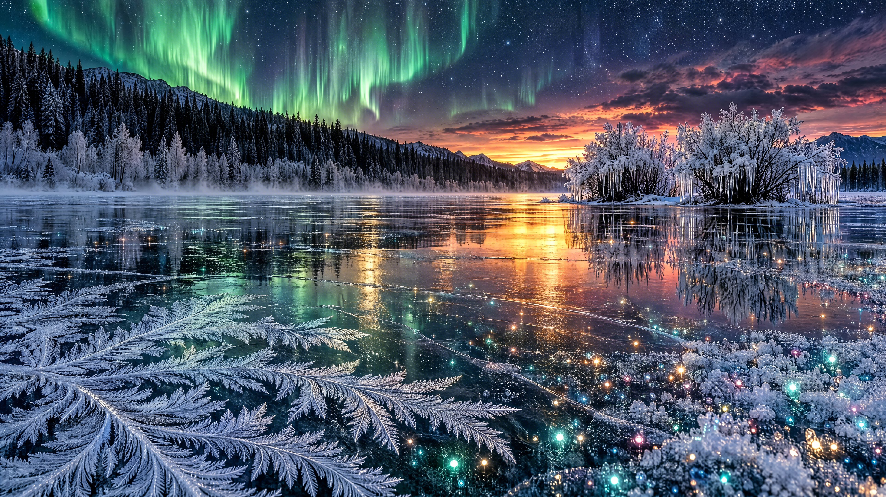

# 「Frosty patterns」：极光下的魔法冰湖夜景，霜冻灌木、冰下彩色光点与前景冰花蕨晶（分区式写实风景 prompt）

- 原帖链接：https://x.com/churvikv/status/2125685392053846024
- 作者：Viki（@churvikv）
- 时间：2026-11-26 04:17 (UTC+8 / Asia/Taipei)
- 互动摘要：点赞 61 · 转发 13 · 回复 15 · 引用 0 · 书签 3 · 浏览 614（采集快照：2026-11-26 09:30 UTC+8）
- 模型/工具：GPT Image 2.5 Sunburst（经 @dreamina_ai，作者标注）
- 标签：其它
- 媒体路径：
  - `media/images/2125685392053846024_1.jpg`（）
- 入库日期：2026-11-26
- 备注：prompt 在主帖正文（长文），从「Photorealistic magical frozen lake」起原样摘录到结尾（略去开头「🏞 Prompt:」标签与工具说明）。按 SKY / FOREST / BUSHES / LAKE / SPARKLES / FOREGROUND / PALETTE 分区描述。

## prompt 原文

```text
Photorealistic magical frozen lake at night under the aurora, wide 16:9 panoramic composition, ultra-detailed. Full bleed, no frame, no border, no lettering.

SKY: a deep indigo star-filled night vault across the upper third, pierced by tall vertical curtains of aurora borealis in luminous emerald, mint and pale jade, their frayed strands hanging and curling like combed light, brightest above the left ridge. Low on the right horizon a warm afterglow of coral, rose and burnt orange streaks through dark cloud bands, fading upward into violet.

FOREST: a long ridge of dense black pine silhouettes spans the middle left, its slopes dusted with frost, needle tips rimmed in white. Paler frosted trees stand in front of it, and a thin veil of ground mist drifts across the shoreline.

BUSHES: right of centre, two large ornamental shrubs are fully encased in white frost, every leaf and branch furred with rime, long glassy icicles hanging from the lower twigs, dark twig fans splaying at their bases. Their shapes reflect perfectly in the ice below.

LAKE: the lower half is smooth black ice, its surface streaked with wind-polished sheen and carrying a broad warm gold and amber reflection of the sunset glow down the centre, plus dark mirror reflections of the shrubs and treeline.

SPARKLES: hundreds of tiny multicoloured light points — turquoise, mint, amber, magenta, pale blue — lie scattered across the ice like fairy lights under the surface, densest across the lower right where the ice turns to sparkling granular snow, glittering in tight clusters.

FOREGROUND: the lower left is dominated by enormous frost fern crystals, flat white branching fronds with fine feathered leaflets radiating across the dark ice, sharply crystalline, catching cold blue light.

PALETTE: deep indigo, emerald, mint, coral orange, warm gold, ice white, charcoal black, turquoise. Hyper-detailed, luminous, high dynamic range.
```

---

个人学习归档，非商业。prompt 与媒体版权归原作者 @churvikv，引用请回到原帖。
