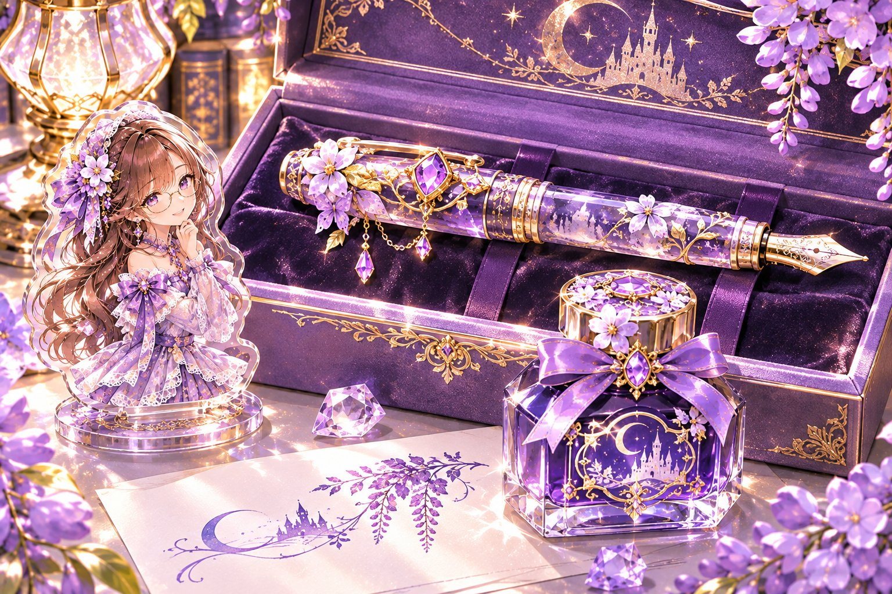
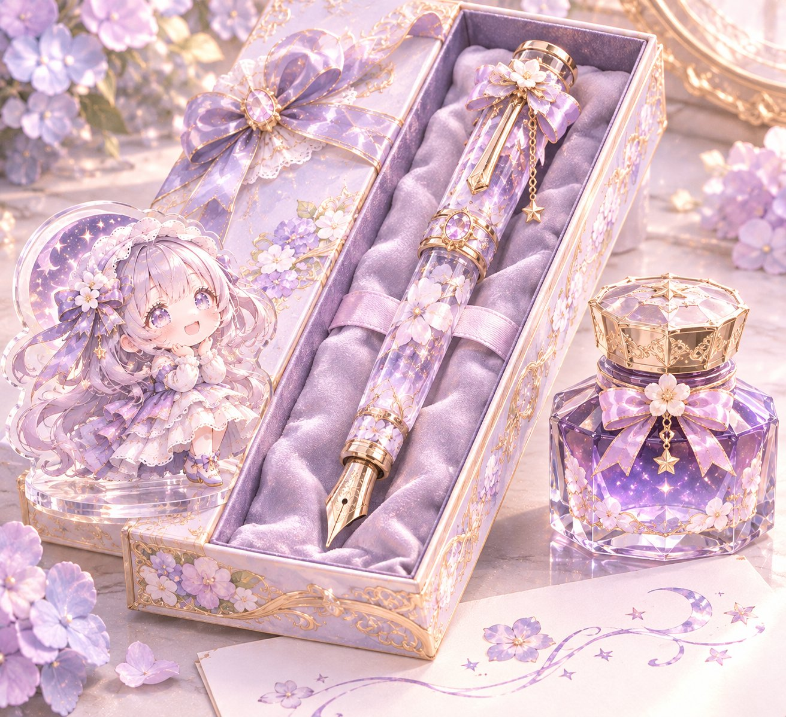

# 「うちの子・専用万年筆」：把自家角色的配色与元素做成限定高级钢笔套装（钢笔 + 专用墨水瓶 + 礼盒 + 亚克力立牌，商品摄影风）

- 原帖链接：https://x.com/AIXyu1v/status/2125741348036960672
- 作者：ゆき　AIイラストXで収益化（@AIXyu1v）
- 时间：2026-11-26 08:00 (UTC+8 / Asia/Taipei)
- 互动摘要：点赞 109 · 转发 22 · 回复 15 · 引用 27 · 书签 26 · 浏览 4415（采集快照：2026-11-26 19:55 UTC+8）
- 模型/工具：未注明
- 标签：二次元
- 媒体路径：
  - `media/images/2125741348036960672_1.jpg`（）
  - `media/images/2125741348036960672_2.jpg`（）
- 入库日期：2026-11-26
- prompt 来源：https://x.com/AIXyu1v/status/2125741350083813440（作者自回复）
- 备注：prompt 在作者自回复（2125741350083813440），整条原样摘录。作者标注「プロンプト配布」「ぜひ好きなキャラで試してみてね」。需上传角色图作参考。同作者今天另有藤花女仆/执事衣装 prompt 帖，按每轮同作者一条的惯例留待下轮。

## prompt 原文

```text
うちの子・専用万年筆 🖋️💎

添付画像のキャラクターを参考に、**その子の個性や世界観を詰め込んだ、世界にひとつだけの高級万年筆**をデザインしてください。

髪色・瞳の色・衣装・アクセサリー・象徴的なモチーフを万年筆のデザインに忠実に反映してください。

【万年筆のデザイン】
・軸：髪色や衣装をイメージした美しい配色
・キャップ：キャラを象徴する繊細な装飾
・ペン先：金属の光沢とオリジナルの彫刻
・クリップ：キャラのアクセサリーをモチーフにした造形

キャラクターの個性に合わせて、宝石、花、星、リボン、和柄などを取り入れてください。

【専用インク・化粧箱】
万年筆に合わせた専用インク瓶を1つ制作。

インクはキャラクターのイメージカラーに合わせ、透明感のある美しい色合いにしてください。

化粧箱には高級感のある布張りの内装と、キャラを象徴する装飾を施してください。

【構図・背景】
**万年筆1本、専用インク瓶1個、化粧箱1個**を美しく並べた商品撮影風の構図。

横には元キャラを再現した小さなアクリルスタンドを飾り、万年筆との共通点が分かるようにしてください。

手前には白い紙を置き、専用インクで描いた美しい曲線や小さなモチーフを添えてください。

【仕上がり】
高品質な3D商品イラスト。繊細な金属細工、宝石のような透明感、美しい光沢、柔らかな照明。

**本当に限定販売されたような、思わず欲しくなる高級万年筆セット**に仕上げてください。

【禁止事項】
元キャラの特徴変更、万年筆の増殖、ペン先の変形、装飾の過剰な融合、実在企業のロゴ、読めない文字、透かし。
```

---

个人学习归档，非商业。prompt 与媒体版权归原作者 @AIXyu1v，引用请回到原帖。
