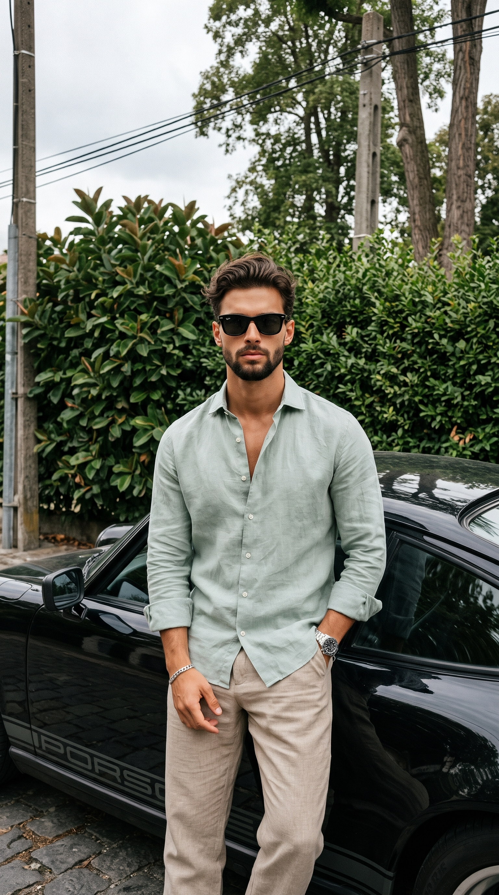

# Old Money 90 年代地中海男装大片：薄荷绿亚麻衬衫男子倚靠黑色复古保时捷 911（带 HEX 色值的超细节人像 prompt）

- 原帖链接：https://x.com/pictsbyai/status/2125866649039347753
- 作者：Picts by AI（@pictsbyai）
- 时间：2026-11-26 16:18 (UTC+8 / Asia/Taipei)
- 互动摘要：点赞 27 · 转发 5 · 回复 17 · 引用 0 · 书签 2 · 浏览 440（采集快照：2026-11-26 19:55 UTC+8）
- 模型/工具：Gemini Nano Banana 2.1（Gemini App，作者标注）
- 标签：真人
- 媒体路径：
  - `media/images/2125866649039347753_1.jpg`（）
- 入库日期：2026-11-26
- 备注：prompt 在主帖正文（长文），从「A medium-full three-quarter portrait」起原样摘录。作者另一条自回复（2125894558881816962）补充了用自己照片做参考时追加的身份参考句，未收入此处。

## prompt 原文

```text
A medium-full three-quarter portrait captures a young athletic handsome man with warm bronze-tan skin (#A67458), wearing a pale mint sage-green long-sleeve linen shirt (#9DB6B2) unbuttoned to mid-chest with cuffs rolled once, paired with warm oatmeal-beige relaxed linen trousers (#C7BAA7). His medium-short dark brown hair features a textured brush-back taper reaching mid-ear with three to four inches of wavy top volume, styled backward without a part in a natural matte finish showing slight frizz and loose crown flyaways. His face holds a composed, posed editorial expression with a closed neutral mouth, neutral eyebrows slightly visible above jet-black wayfarer sunglasses (#161818) facing directly forward. Centered in a symmetric, wide A-frame stance with level relaxed shoulders, he leans straight-on against a pristine glossy jet-black vintage Porsche 911 coupe (#161818). His left hand is casually tucked into his front trouser pocket up to a metallic wristwatch cuff, while his relaxed right hand—adorned with a silver chain link bracelet—rests naturally against his upper right thigh with thumb and index finger loosely extended and outer fingers gently curled. The midground car displays a curved rear quarter window, black side mirror, and a subtle matte dark-on-dark geometric sans-serif "PORSCHE" stencil decal along the lower rocker panel above charcoal-gray stone street pavers (#26282A). Behind the car stretches a thriving, dense broadleaf evergreen ficus and privet hedge in deep forest green (#334736) with rough, semi-glossy layered leaves, backed by weathered concrete and metal utility poles, horizontal black overhead power lines, tall brownish-gray deciduous tree trunks with leafy canopies, and an overcast gray-white sky (#D8DBD6). Diffused natural daylight from above and slightly front-left provides soft, moderately directional illumination with medium contrast and ambient sky fill, casting short, soft-edged gray shadows under the jawline, inside the collar, along trouser folds, and beneath the car, while preserving highlights on the forehead, nose bridge, and fabric alongside specular reflections on the car glass and roofline. Shot at eye level with a 35mm or 50mm prime lens at f/4.0, 1/500s, and ISO 400 in an Old Money 1990s Mediterranean menswear editorial aesthetic, the image exhibits medium depth of field, slightly soft sharpness, lifted blacks, desaturated greens, warm skin calibration, and heavy 35mm analog film grain, framed in a 9:16 vertical portrait aspect ratio.
```

---

个人学习归档，非商业。prompt 与媒体版权归原作者 @pictsbyai，引用请回到原帖。
