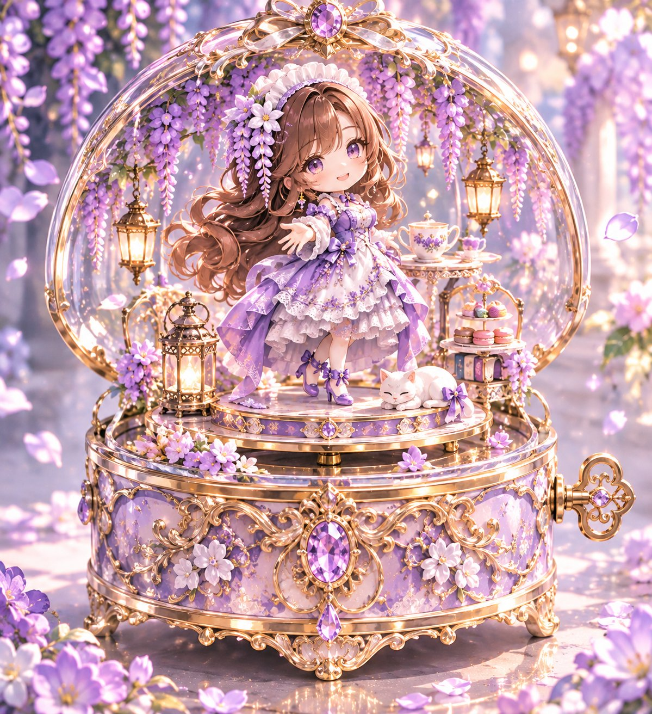
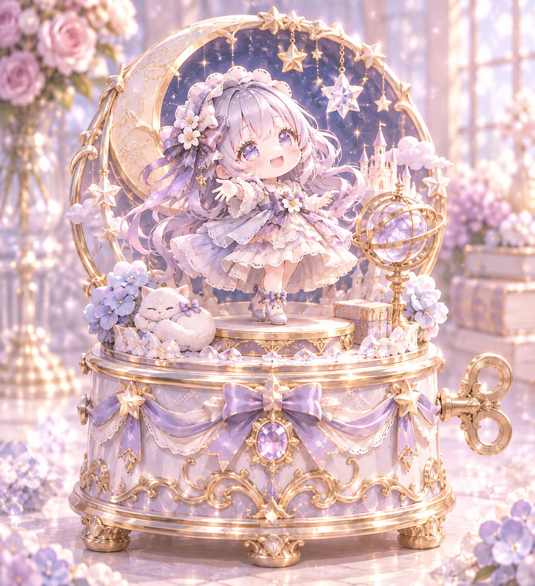

# 「うちの子・オルゴール化」：把自家角色做成二头身小手办立在旋转台上的古董风八音盒（按角色性格选舞台主题，商品摄影风）

- 原帖链接：https://x.com/AIXyu1v/status/2125537487787548859
- 作者：ゆき　AIイラストXで収益化（@AIXyu1v）
- 时间：2026-11-25 18:30 (UTC+8 / Asia/Taipei)
- 互动摘要：点赞 74 · 转发 15 · 回复 7 · 引用 15 · 书签 26 · 浏览 3784（采集快照：2026-11-27 09:30 UTC+8）
- 模型/工具：未注明
- 标签：二次元
- 媒体路径：
  - `media/images/2125537487787548859_1.jpg`（）
  - `media/images/2125537487787548859_2.jpg`（）
- 入库日期：2026-11-27
- prompt 来源：https://x.com/AIXyu1v/status/2125537489792516492（作者自回复）
- 备注：prompt 在作者自回复（2125537489792516492），整条原样摘录。作者标注「プロンプト配布」「好きなキャラで試してみてね」。需上传角色图作参考。上轮备选；同作者 11-26 的「専用万年筆」已收录，今天另有「専用家具ブランド」「ブロッコリー」两条留作备选。

## prompt 原文

```text
うちの子・オルゴール化 🎶💎

添付画像のキャラクターを参考に、**その子の世界観を詰め込んだ、世界にひとつだけのオルゴール**を描いてください。

髪型・髪色・瞳・衣装・アクセサリーなど、元キャラの特徴を忠実に再現してください。

【シーン】
美しいアンティーク調のオルゴール。

中央の円形回転台には、キャラクターを再現した可愛いミニフィギュアが立っています。

キャラクターの周囲には、その子の世界観を表現した小さな装飾が広がっています。

【オルゴールのデザイン】
キャラクターの性格やモチーフに合わせて、自由にデザインしてください。

・可愛い系：リボンとお菓子の舞台 🎀
・癒やし系：花と蝶の小さな庭 🌷
・クール系：氷の結晶と銀細工 ❄️
・幻想系：三日月と星空の舞台 🌙
・元気系：カラフルなメリーゴーランド 🎠

上記以外の世界観でも構いません。

【可愛さのポイント】
・精巧な二頭身ミニフィギュア
・キャラのイメージカラーを使った台座
・繊細な金属細工や宝石の装飾
・側面に付いた小さなゼンマイの巻き鍵
・優しいメロディーが聞こえてきそうな雰囲気

【構図・背景】
**キャラクターのフィギュア1体と、オルゴール全体が見える構図。**

フィギュアは円形回転台の中央に固定され、周囲に小さな装飾をバランスよく配置してください。

台座にはアンティーク調の彫刻や金色の縁取りを施してください。

背景は淡いパステルカラー。柔らかな光と幻想的な輝きで、高級なコレクションアイテムの商品撮影風に仕上げてください。

【仕上がり】
高品質な3Dフィギュア風イラスト。精巧な立体造形、陶器のような光沢、繊細な金属装飾、温かみのあるアンティークな質感、夢のような美しい世界観。

【禁止事項】
元キャラの特徴変更、人物の追加、フィギュアの増殖、台座の変形、フィギュアと装飾の不自然な融合、余分な手足、顔や手の崩れ、文字、ロゴ、透かし。
```

---

个人学习归档，非商业。prompt 与媒体版权归原作者 @AIXyu1v，引用请回到原帖。
