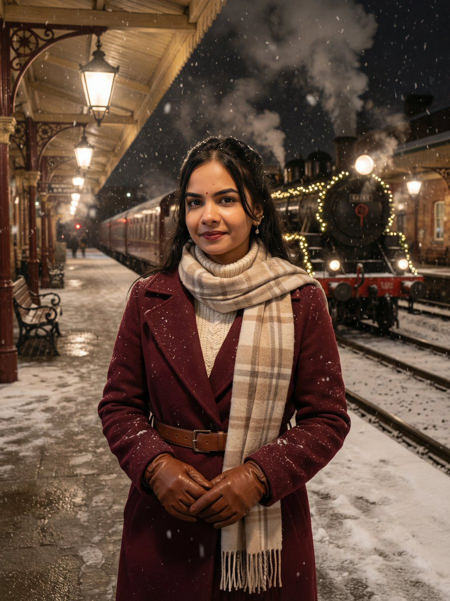

# 雪夜车站的酒红大衣女子：蒸汽机车与金色花环前的超写实电影感人像（Sony A7R IV 85mm）

- 原帖链接：https://x.com/runaroseee/status/2125590335795441799
- 作者：Runa Rose（@runaroseee）
- 时间：2026-11-25 22:00 (UTC+8 / Asia/Taipei)
- 互动摘要：点赞 52 · 转发 6 · 回复 35 · 引用 0 · 书签 3 · 浏览 591（采集快照：2026-11-27 09:30 UTC+8）
- 模型/工具：未注明
- 标签：真人
- 媒体路径：
  - `media/images/2125590335795441799_1.jpg`（）
- 入库日期：2026-11-27
- 备注：prompt 在主帖正文，从「A hyperrealistic cinematic portrait」起原样摘录到结尾（略去开头一句配文与「Prompt :」标签）。成年女性，衣着完整，非性化。

## prompt 原文

```text
A hyperrealistic cinematic portrait of a young woman standing on a snowy train platform at night, calm confident gaze toward the camera, hands gently clasped in front of her, flawless matte complexion, winged eyeliner with neutral smoky eyeshadow, deep berry red lips, long Auburn hair styled in soft romantic waves with a few delicate strands framing her face, small drop earrings, wearing a deep burgundy wool coat with a wide collar cinched at the waist with a brown leather belt over a cream turtleneck, matching brown leather gloves, a beige cashmere plaid scarf wrapped around her neck, a majestic black steam locomotive behind her decorated with twinkling golden garlands tracing its contours, plumes of white steam drifting into the night air, vintage street lanterns glowing warmly along the platform, fresh snow covering the ground with snowflakes actively falling, dark moody night sky, softly blurred background with shallow depth of field, shot on Sony A7R IV with 85mm f/1.4 lens, dramatic yet natural lighting, rich deep tones with contrasting highlights, ultra detailed textures of wool, leather, snow, steam and metal, 8K resolution, ultra realistic, vertical composition.
```

---

个人学习归档，非商业。prompt 与媒体版权归原作者 @runaroseee，引用请回到原帖。
