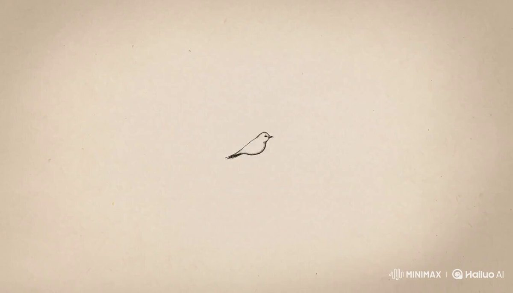

# 15 秒动画史动态图形：从走马盘、翻页书、放映机、赛璐珞到 3D 线框与 AI 的「给画赋予生命」（MiniMax H3）

- 原帖链接：https://x.com/ai_animer/status/2125884771402227951
- 作者：雨雲(Amagumo)806 ｜ AI Animer（@ai_animer）
- 时间：2026-11-26 17:30 (UTC+8 / Asia/Taipei)
- 互动摘要：点赞 31 · 转发 4 · 回复 2 · 引用 0 · 书签 1 · 浏览 507（采集快照：2026-11-27 09:30 UTC+8）
- 模型/工具：MiniMax H3（Hailuo，作者标注）
- 标签：其它
- 媒体路径：
  - `media/video-stills/2125884771402227951_still.jpg`（视频封面截图，）
  - 视频本体未入库，仅保留原帖链接：https://x.com/ai_animer/status/2125884771402227951
- 入库日期：2026-11-27
- prompt 来源：https://x.com/ai_animer/status/2125885355031433485（作者自回复）
- 备注：prompt 在作者自回复（2125885355031433485），整条原样摘录（含分镜时间码、音效与配乐描述）。视频本体未入库，仅保留原帖链接。

## prompt 原文

```text
integrated_multimodal_description: [Shot 1] 2D-animated cinematic motion graphics with a vintage-to-modern editorial design, combining hand-drawn pencil sketches, cream paper textures, film grain, painted cel layers, wireframe grids, bold kinetic typography, and warm cream, graphite gray, ink black, cel red, sky blue, and golden yellow accents. The opening begins on a sheet of cream paper as a single pencil sketch of a small bird in mid-flap draws itself line by line. The sketch multiplies into a ring of twelve slightly different bird drawings around the inside of a generic wooden spinning drum with narrow viewing slits, and the drum begins to rotate. Oversized typography assembles from individual pencil strokes while the camera pushes in at slow speed toward the spinning drum. Visible text appears with strong kinetic motion: "ANIMATION BEGAN AS DRAWINGS THAT SPUN." Smaller date text snaps beneath it: "1830s". Pencil construction lines, circles, and frame numbers animate around the words.

[Shot 2] At 00:02.500, the shot cuts to a stylized paper-era composition. Stacks of loose sketch pages, small flip books, and sequences of bird drawings fan across the frame in long rhythmic rows, each page carrying one drawing. The camera trucks right with large amplitude at fast speed as the pages fan past the lens and the typography follows the movement, stretching and snapping into alignment. Visible text builds in three beats, each phrase stacking on its own line beneath the previous one so that all three stay visible together: "ONE DRAWING." then "ANOTHER." then "AND ANOTHER." Each phrase enters with a different rhythmic motion synchronized to the riffle of paper. Small date text reads "1860s–1900s".

[Shot 3] At 00:05.000, the shot cuts to a black-and-white early-cinema composition built from flat geometric shapes, a generic hand-cranked film projector, a glowing beam of light, film-strip frames, flicker, and scratches. A long strip of film filled with bird drawings rapidly threads through the projector, each frame sliding into place. The camera pushes in toward the projected rectangle of light while chunky silent-film typography types itself inside the projected frame one character at a time: "THE DRAWINGS MOVED FROM THE PAGE..." The projected frame flashes white, and the sentence continues outside the frame in giant kinetic text: "...TO THE SCREEN." The letters stay crisp and legible as they grow. Small date text appears: "1910s–1920s". Sprocket holes, title-card borders, and film-leader numbers expand outward from the light.

[Shot 4] At 00:07.500, the shot transitions into the color era. Transparent painted cels, brush strokes, paint jars, layered watercolor backgrounds, and the glow of a generic vintage television screen multiply rapidly across the frame as sepia gives way to saturated color. The camera pushes in with large amplitude at fast speed through overlapping glass cel layers that slide at different depths. Visible text appears in sequence, each word occupying the entire frame before being pushed away by the next: "PAINTED." "LAYERED." "BROADCAST." Smaller text reads "1930s–1980s". The typography accelerates as the layers become denser, and the palette shifts into bright cel red, sky blue, and golden yellow.

[Shot 5] At 00:10.000, the scene transforms into a sleek digital composition. A glowing wireframe mesh of the bird assembles from points and lines, then fills into a smooth shaded 3D bird, while keyframe curves, timeline tracks, and render tiles orbit around it in smooth geometric motion. The camera moves in an arc shot around the bird. Data particles stream along the keyframe curves while the typography bends and follows their paths. Visible text appears: "DRAWINGS BECAME DATA." followed by "DATA BECAME WORLDS." Small date text appears: "1990s–2010s". The color palette shifts from sky blue and cyan into brighter magenta and electric violet.

[Shot 6] At 00:12.500, the shot cuts to a contemporary studio composition where a hand-drawn pencil bird on a sheet of cream paper is traced by soft glowing guide lines that extend its strokes into fluid motion, surrounded by translucent interface panels, color swatches, and sketch thumbnails. The camera pulls out with large amplitude at fast speed, revealing that the entire timeline forms one continuous ribbon of film frames curling through space. Earlier visual motifs—the spinning drum, fanning pages, film strip, painted cels, and wireframe bird—briefly reappear as layered silhouettes inside the ribbon. Small date text appears: "2026". Giant condensed typography builds from the center in three beats, each word stacking on its own line beneath the previous one so that all three stay visible together: "HAND-DRAWN." then "PROJECTED." then "AI-ASSISTED." At 00:14.000, the three words dissolve into a single glowing pencil line that draws the flying bird once more, and the final visible text resolves cleanly beside the bird as one sentence stacked on three lines, first line "THE HISTORY OF ANIMATION", second line "IS THE HISTORY OF", third line "GIVING DRAWINGS LIFE." The lower-right corner of the frame stays clear of text. Hold the final composition for the remaining duration while the pencil bird keeps flapping gently behind the text.

overall_soundscape: Pencil scratches, paper riffles, the wooden rattle of a spinning drum, the clatter of a hand-cranked film projector, soft brush strokes on glass, a faint television hum, digital render chimes, and gentle interface shimmers evolve chronologically across the video. Each transition is punctuated by a crisp paper snap or electronic impact synchronized with the typography.

non_diegetic_music: A fast evolving instrumental track at approximately 128 BPM, beginning with a solo music box and pizzicato strings, gradually adding upright piano, brushed drums, full strings, brass hits, sequenced synthesizers, and digital drums as the timeline advances. The music becomes fullest in the final contemporary section, lands on a sustained orchestral chord at 00:13.500, and lets that chord ring out and fade naturally to silence by the final frame.
```

---

个人学习归档，非商业。prompt 与媒体版权归原作者 @ai_animer，引用请回到原帖。
