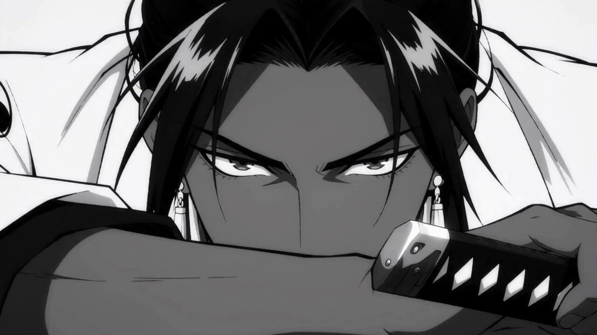

# 「EGANIS MANGA ESCAPE」：角色冲破漫画分格、在立体化的漫画页里跨格穿梭打斗的 10 秒动画 prompt

- 原帖链接：https://x.com/G8k9jrh5T580304/status/2125886114343043296
- 作者：ジジはAI漫画部族（@G8k9jrh5T580304）
- 时间：2026-11-26 17:35 (UTC+8 / Asia/Taipei)
- 互动摘要：点赞 45 · 转发 5 · 回复 4 · 引用 2 · 书签 24 · 浏览 2343（采集快照：2026-11-27 09:30 UTC+8）
- 模型/工具：Seedance 2.0（作者推荐）
- 标签：二次元
- 媒体路径：
  - `media/video-stills/2125886114343043296_still.jpg`（视频封面截图，）
  - 视频本体未入库，仅保留原帖链接：https://x.com/G8k9jrh5T580304/status/2125886114343043296
- 入库日期：2026-11-27
- prompt 来源：https://x.com/G8k9jrh5T580304/status/2125886313081749535（作者自回复）
- 备注：prompt 在作者自回复（2125886313081749535），从「EGANIS MANGA ESCAPE TENDER v1.1」起原样摘录到结尾（略去开头的日文使用说明：推荐模型 Seedance 2.0、10 秒、参考图为角色 1 张，角色/武器/画风/动作可自由更改）。作者标注「AI動画プロンプト無料配布」。视频本体未入库，仅保留原帖链接。

## prompt 原文

```text
EGANIS MANGA ESCAPE TENDER v1.1

MANGA PANEL BREAK × 3D SPATIAL ACTION

ROLE:

Transform the provided character into a
dynamic manga animation in which the
character physically escapes from comic
panels and moves freely through a
three-dimensional manga page.

01 | REFERENCE LOCK

Use the provided image as the sole
character identity and art-style reference.

Preserve:
- Character identity and facial features
- Hair, clothing and accessories
- Body proportions
- Original weapons and equipment
- Character personality
- Original visual style

If the reference is a character sheet,
extract only the character identity.
Never reproduce the reference sheet layout.

02 | MANGA WORLD STRUCTURE

Create a Japanese manga page containing
5–6 asymmetrical comic panels.

Use varied panel sizes, distinct
environments, bold black panel borders
and clean white gutters.

Each panel functions as an independent
spatial environment with its own depth.

The manga page is not a flat background.
It is a three-dimensional action stage.

Panel borders function as physical
boundaries, platforms and obstacles.

03 | MAIN VISUAL GOAL

The character breaks through the original
manga panel and rapidly travels between
multiple surrounding panels.

The character must physically cross,
overlap and interact with panel borders.

Create unmistakable out-of-frame effects,
strong foreshortening, foreground
occlusion and dynamic spatial movement.

The character can move:

- Inside individual panels
- Across white gutters
- In front of panel borders
- Behind foreground panel borders
- Toward and away from the viewer
- Between environments at different depths

04 | COMPOSITING ORDER

Layer 1:
White manga paper and negative space.

Layer 2:
Independent environments inside panels.

Layer 3:
Black manga panel borders.

Layer 4:
Escaping character, moving limbs,
clothing, weapons and accessories.

Layer 5:
Foreground ink fragments, speed lines
and controlled impact effects.

The character's layer priority changes
naturally according to spatial movement.

Do not clip the character at panel borders
during intentional frame-breaking actions.

05 | ACTION TIMELINE — 10 SECONDS

0–1.5s | FRAME BREAK

The character performs a signature action
to break through the original panel border.

Immediately launch toward the viewer.

Use a sharp impact, scattered ink fragments
and strong perspective exaggeration.

1.5–3s | SPATIAL REVEAL

The camera rapidly pulls back and tilts,
revealing the manga page as a
three-dimensional action space.

The character travels above the white
gutters and overlaps multiple panel edges.

3–5s | PANEL LEAP

The character uses a panel border as
a physical platform, pushes off and
leaps diagonally into another panel.

Briefly land and immediately launch again.

5–7s | DEPTH TRANSITION

Dive through a narrow vertical panel.

Pass behind one panel border and
in front of another.

Emphasize parallax, depth separation,
foreshortening and rapid directional changes.

7–9s | HIGH-SPEED TRAVERSAL

Rapidly cross multiple manga panels
and white gutters.

Use controlled speed lines, directional
motion blur, ink trails and impact accents.

Maintain continuous physical movement
between environments.

9–10s | FINAL LANDING

Land inside the final large manga panel.

Perform a short finishing gesture
appropriate to the character's personality.

End with a strong, readable manga composition.

06 | CAMERA CONTROL

Dynamic continuous tracking camera.

Use controlled:
- Dolly movements
- Camera tilting
- Short orbital movements
- Perspective shifts
- Foreground parallax
- Rapid tracking acceleration

Camera movement must follow the
character's physical action.

Maintain readable panel geography.

Avoid unnecessary cuts or random
camera rotations.

07 | MOTION DESIGN

Fast, forceful and continuous movement.

Prioritize:
- Strong anticipation
- Explosive acceleration
- Clear action silhouettes
- Immediate follow-through
- Natural hair and clothing movement
- Dynamic changes in depth
- Brief and powerful impact frames

Avoid prolonged standing, slow walking
and unnecessary idle moments.

08 | VISUAL STYLE

Professional Japanese manga aesthetic.

Crisp expressive ink linework,
strong black and white contrast,
restrained screentones,
dynamic perspective and speed lines.

Preserve the character's original
design and rendering identity.

Default to monochrome manga.
Color manga is optional.

09 | SOUND DESIGN

Synchronize sound with physical actions.

Use:
- Paper tearing or slicing sounds
- Sharp impact sounds
- Rapid wind rushes
- Landing impacts
- Character-specific action sounds

No unnecessary dialogue or music.

10 | NEGATIVE CONSTRAINTS

No duplicate characters.
No character redesign.
No reference sheet reproduction.
No random panel generation.
No uncontrolled panel deformation.
No slideshow-like transitions.
No simple flat horizontal walking.
No teleportation without spatial continuity.
No excessive slow motion.
No unnecessary idle pauses.
No photorealistic style conversion.
No random text or subtitles.

Maintain consistent character identity,
clear spatial relationships and
continuous high-speed action.

OUTPUT:
10-second dynamic manga animation.
16:9 cinematic composition.
```

---

个人学习归档，非商业。prompt 与媒体版权归原作者 @G8k9jrh5T580304，引用请回到原帖。
