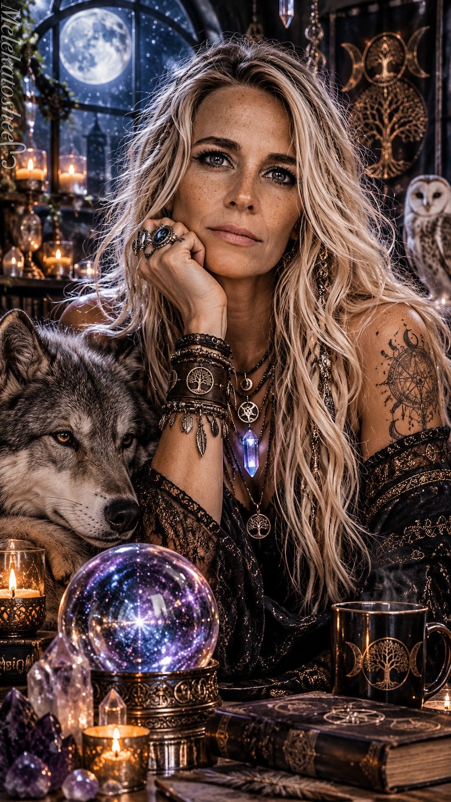

# 「我天生该做什么职业？」：让 AI 根据你们的历史对话推断一份意想不到的职业，并用你的照片生成 9:16 电影感工作照

- 原帖链接：https://x.com/Melekatoshee/status/2125895076328993053
- 作者：Melekatoshee ᥫ᭡.（@Melekatoshee）
- 时间：2026-11-26 18:10 (UTC+8 / Asia/Taipei)
- 互动摘要：点赞 26 · 转发 5 · 回复 10 · 引用 1 · 书签 1 · 浏览 607（采集快照：2026-11-27 20:05 UTC+8）
- 模型/工具：未注明（需支持记忆/上传照片的对话式图像模型）
- 标签：真人
- 媒体路径：
  - `media/images/2125895076328993053_1.jpg`（）
- 入库日期：2026-11-27
- 备注：prompt 在主帖图片 ALT 里，整段原样摘录。作者注明 prompt 原作者为 @Boho_Sam_（「An amazing prompt by @Boho_Sam_」），本帖是作者自己的跑图结果（AI 给出「Immersive World Architect & Mythmaker」）；正文长段为 AI 回答，未收入 prompt。需上传本人照片作参考。

## prompt 原文

```text
Based on everything you've learned about me through our conversations, I want you to imagine something.

What career do you genuinely think I was born to do?

Consider my personality, natural talents, creativity, sense of humor, interests, passions, strengths, weaknesses, habits, and the way I interact with others.

Don't just pick something similar to what I already do. Think completely outside the box!

Choose ONE career that you believe fits the real me best.

CREATE A STUNNING, 9:16 ASPECT RATIO ULTRA-REALISTIC CINEMATIC IMAGE OF ME ACTUALLY DOING THAT JOB!

Use my uploaded photo as a reference and preserve my recognizable facial features. Dress me appropriately for the career and place me in a detailed, realistic work environment.

IMPORTANT: Don't flatter me, don't automatically choose my current profession, and don't give me a generic answer. I want your genuine interpretation of who I am, not just what I do for a living.

SURPRISE ME!
```

---

个人学习归档，非商业。prompt 与媒体版权归原作者 @Melekatoshee，引用请回到原帖。
