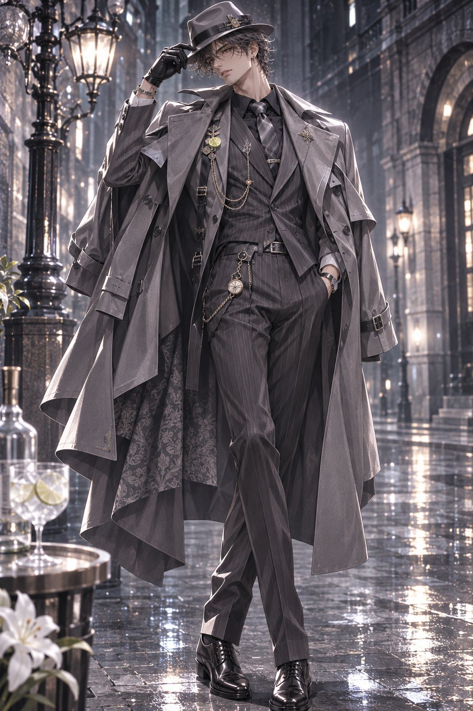
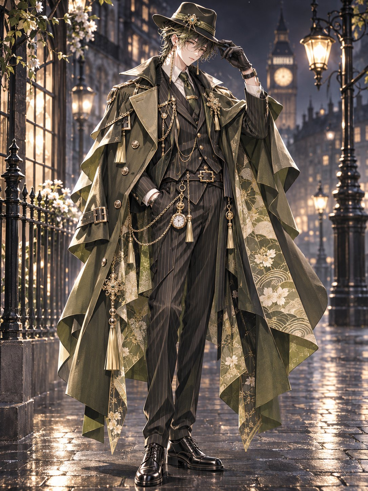
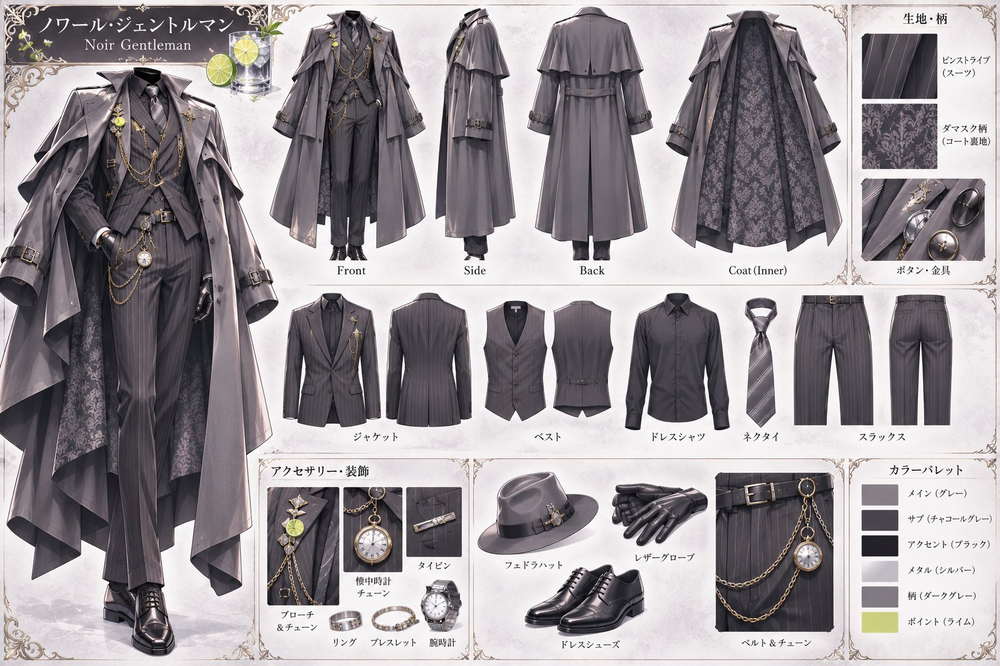

# 「ノワール・ジェントルマン」衣装：烟灰 × 黑 × 银的英伦绅士三件套 + 斗篷式长风衣 + 软呢帽（金汤力 / 大马士革纹主题）

- 原帖链接：https://x.com/jirihin_ai/status/2125924856449384902
- 作者：じりひん　プロンプト配布・うちの子AIイラスト垢（@jirihin_ai）
- 时间：2026-11-26 20:09 (UTC+8 / Asia/Taipei)
- 互动摘要：点赞 78 · 转发 13 · 回复 2 · 引用 3 · 书签 49 · 浏览 2531（采集快照：2026-11-27 09:30 UTC+8）
- 模型/工具：未注明
- 标签：二次元
- 媒体路径：
  - `media/images/2125924856449384902_1.jpg`（）
  - `media/images/2125924856449384902_2.jpg`（）
  - `media/images/2125924856449384902_3.jpg`（）
- 入库日期：2026-11-27
- 备注：prompt 在主帖第 1 张图的 ALT 里，整段原样摘录（作者说明可用 ALT 或第 3 张衣装设计图，颜色与主题可自行替换，FF 外可用）。示例为成年男性角色，非性化。

## prompt 原文

```text
【衣装名：ノワール・ジェントルマン】

英国紳士風のクラシカルなノワールファッション。
大人の色気と気品が漂う衣装。

【カラー設定】

- メインカラー：スモーキーグレー
- サブカラー：ブラック
- アクセントカラー：シルバー

【モチーフ】
ジントニック
ダマスク柄

【衣装の詳細】

■帽子

- クラシカルなフェドラハット。
- やや広めのブリムと、深みのある帽体。
- ハットバンドを巻き、中央に小さな装飾金具と宝石風のブローチを配置。
- 大人っぽく落ち着いたシルエット。

■ アウター

- 膝下丈のロングトレンチコート。
- 肩周りにボリュームを持たせた、マントのように優雅に広がるケープ風シルエット。
- 大きく立体的なテーラードラペル。
- ダブルブレスト仕様で、フロントに大きなボタンを配置。
- 袖口にはベルトとバックル装飾。
- 裏地にはモチーフをイメージした繊細な柄装飾。
- 歩くたびに美しく揺れる、重厚感のある上質な生地。
‐ 重くなりすぎないよう綺麗なシルエットを保つ

■ インナー

- 襟元まできちんと整えたクラシカルなワイシャツ。
- ネクタイには控えめなタイピンを装着。

■ スリーピーススーツ

- ピンストライプ柄。
- 身体のラインに沿った細身のテーラードジャケット。
- 同素材のシングルブレストベスト。
- シャープなシルエットのスラックス。
- ベストは身体にフィットした上品な仕立て。
- ジャケットの胸元には装飾ブローチ。
- 胸元から垂れる複数のチェーンを配置。

■ ウエスト・装飾

- レザーベルト。クラシカルなバックル。
- 腰部分には懐中時計をモチーフにしたチェーンアクセサリー。
- チェーンには小さな時計盤や円形の装飾チャームを取り付ける。
- 装飾は左右非対称に配置し、アンティークな雰囲気を演出。

■ 手袋

- 上質なレザーグローブ。
- 手首にはブレスレットや腕時計。
- 小ぶりなアンティークリング。
- 装飾は華美になりすぎず、洗練された紳士らしさを重視。

■ 靴

- 光沢感のあるレザーオックスフォードシューズ。
- クラシカルなレースアップ仕様。
- 厚すぎない重厚なソール。
- 丁寧に磨き上げられた鏡面仕上げ。
```

---

个人学习归档，非商业。prompt 与媒体版权归原作者 @jirihin_ai，引用请回到原帖。
