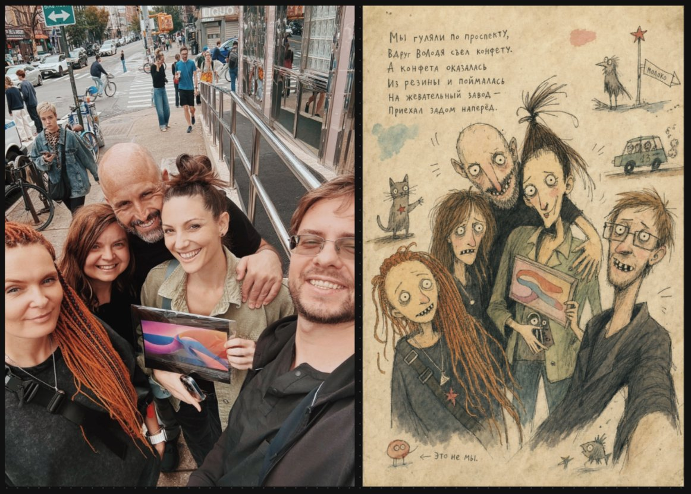

# 把照片变成 80 年代东欧（苏联）儿童绘本风怪诞插画：颤抖墨线、褪色水彩、配一段押韵混乱的俄文

- 原帖链接：https://x.com/icreatelife/status/2126025974479274054
- 作者：Kris Kashtanova（@icreatelife）
- 时间：2026-11-27 02:51 (UTC+8 / Asia/Taipei)
- 互动摘要：点赞 77 · 转发 3 · 回复 9 · 引用 1 · 书签 66 · 浏览 7151（采集快照：2026-11-27 09:30 UTC+8）
- 模型/工具：未注明
- 标签：其它
- 媒体路径：
  - `media/images/2126025974479274054_1.jpg`（）
- 入库日期：2026-11-27
- prompt 来源：https://x.com/icreatelife/status/2126029116206092413（作者自回复）
- 备注：prompt 在作者自回复（2126029116206092413），从「Turn this photo」起原样摘录到结尾（略去开头「Prompt:」标签）。需上传一张照片；示例为作者与同伴的合影 → 怪诞绘本插画对照图。

## prompt 原文

```text
Turn this photo into a strange vintage Soviet children's book illustration with grotesque humorous cartoon energy. Use thin shaky black ink lines, awkward anatomy, elongated limbs uncomfortable facial expressions, chaotic movement, weird proportions, sparse composition, and intentionally clumsy drawing style. Make the characters look slightly absurd nervous. and ridiculous rather than cute. Use pale faded watercolor washes, dirty paper texture, uneven coloring, washed-out muted colors, lots of empty space, careless sketchy linework, and rough old-print illustration texture Keep the background minimal and random, with small strange details and loose doodles. The mood should feel weird, humorous, slightly unsettling, and authentically like an old Eastern European children's book illustration from the 1980s. Do NOT make it polished, aesthetic, modern, cute, detailed, or realistic. Write an absurd text in Russian that is slightly related to the illustration, but not much, with a confusing rhyme. The font is handwritten, clumsy as an illustration style
```

---

个人学习归档，非商业。prompt 与媒体版权归原作者 @icreatelife，引用请回到原帖。
