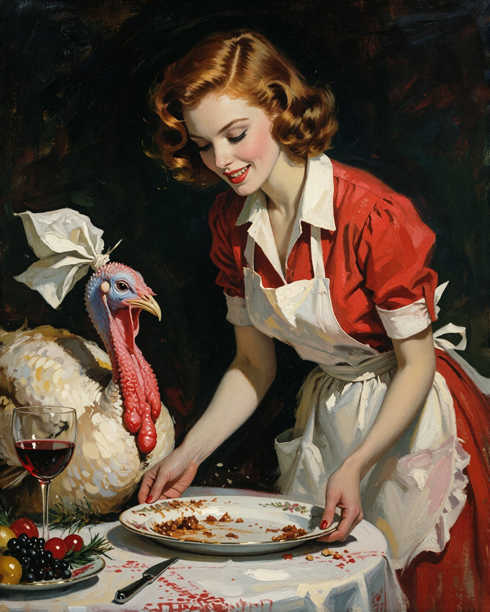

# 「Freedom from Want」感恩节恶搞：仿 Norman Rockwell 名画，火鸡成了座上宾、主妇端上空盘（暗黑奇幻油画笔触）

- 原帖链接：https://x.com/NayaVerseee/status/2126035764093804860
- 作者：Naya（@NayaVerseee）
- 时间：2026-11-27 03:30 (UTC+8 / Asia/Taipei)
- 互动摘要：点赞 42 · 转发 3 · 回复 4 · 引用 1 · 书签 1 · 浏览 513（采集快照：2026-11-27 20:05 UTC+8）
- 模型/工具：未注明
- 标签：其它
- 媒体路径：
  - `media/images/2126035764093804860_1.jpg`（）
- 入库日期：2026-11-27
- 备注：prompt 在主帖图片 ALT 里，整段原样摘录。作者写「Try it with your character」，prompt 中的「Naya」是作者自家角色名，可替换为自己的角色。画面为 50 年代连衣裙 + 围裙的成年女性（prompt 写明 late twenties），非性化。

## prompt 原文

```text
dark fantasy oil painting, visible brush strokes. Medium shot after Norman Rockwell, Naya, a red-haired woman in her late twenties in a fitted fifties dress and white apron, leans over a holiday table setting down an empty platter, smiling at a live turkey seated at the head, napkin tied on.
```

---

个人学习归档，非商业。prompt 与媒体版权归原作者 @NayaVerseee，引用请回到原帖。
