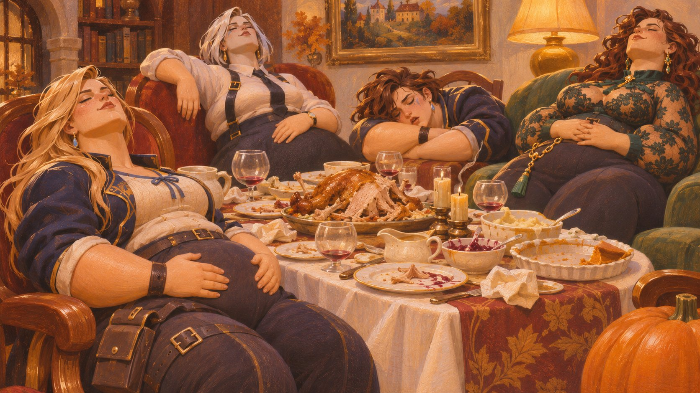
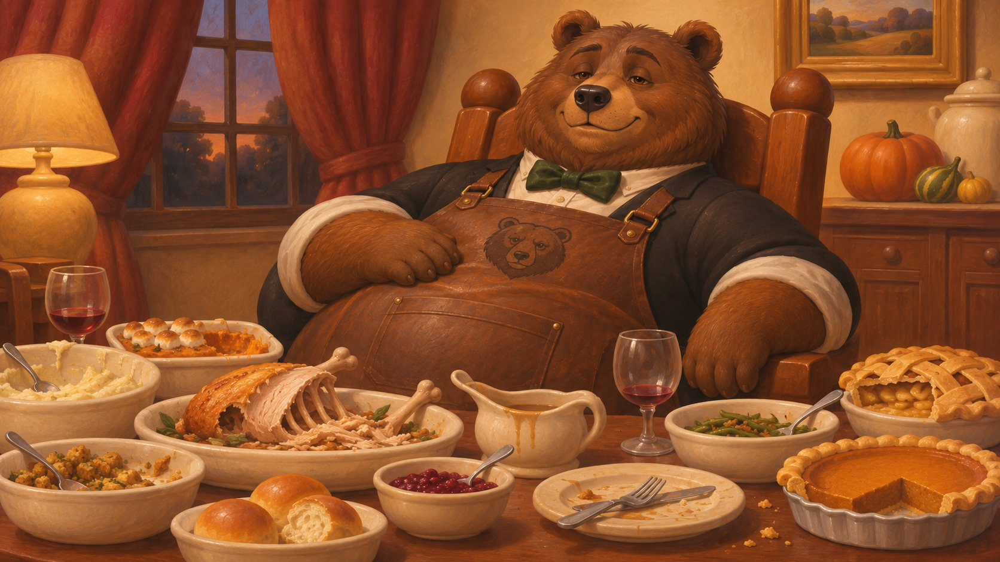
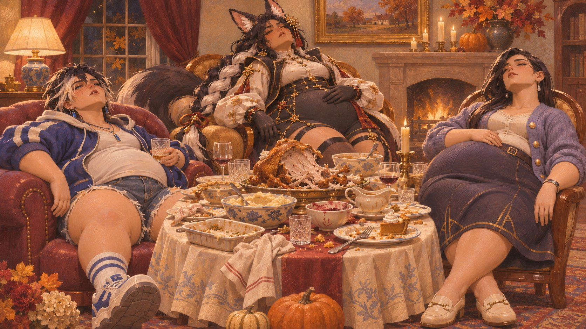
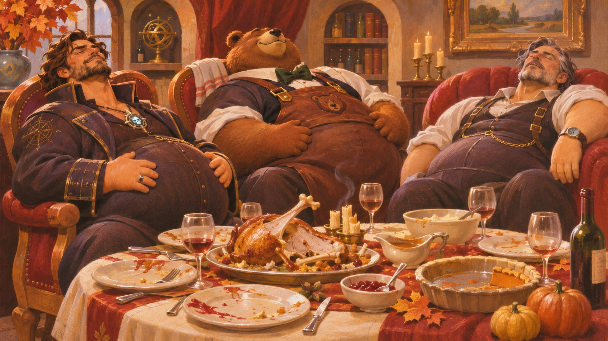

# 「Thanksgiving — The Glorious Aftermath」：上传任意数量角色设定图，按费尔南多·博特罗风重塑成圆滚滚的饱餐后众生相（16:9 长结构 prompt）

- 原帖链接：https://x.com/Le_Tavernicole/status/2126051005205000686
- 作者：Le Tavernicole（@Le_Tavernicole）
- 时间：2026-11-27 04:30 (UTC+8 / Asia/Taipei)
- 互动摘要：点赞 39 · 转发 3 · 回复 6 · 引用 2 · 书签 6 · 浏览 784（采集快照：2026-11-27 20:05 UTC+8）
- 模型/工具：未注明
- 标签：其它
- 媒体路径：
  - `media/images/2126051005205000686_1.jpg`（）
  - `media/images/2126051005205000686_2.jpg`（）
  - `media/images/2126051005205000686_3.jpg`（）
  - `media/images/2126051005205000686_4.jpg`（）
- 入库日期：2026-11-27
- prompt 来源：https://x.com/Le_Tavernicole/status/2126051049878556733（作者自回复）
- 备注：prompt 在作者自回复（2126051049878556733），整条原样摘录（作者原文自带 Markdown 转义反斜杠，保留未改）。作者说明为致敬 Fernando Botero 的戏仿/喜剧向 prompt，示例全部用作者自己的 OC；prompt 负面约束写明 no body-shaming、no vulgar comedy。同作者另有「Victorian Straitjacket」衣装 prompt 帖，题材为束缚衣，按保守原则未收。

## prompt 原文

```text
\# UNIVERSAL THANKSGIVING — THE GLORIOUS AFTERMATH
\## FERNANDO BOTERO — THE MONUMENTAL ART OF OVERINDULGENCE
\### Boterismo × Domestic Comedy × Monumental Volumetry × Festive Aftermath

\*\*FORMAT:\*\* Landscape 16:9.

\*\*CHARACTER REFERENCES:\*\* @Image1, @Image2, @Image3… — Any number of uploaded characters.

\*\*[EMOTION/TONE: blissfully satiated / exhausted / peaceful / comical]\*\*

\*\*ARTISTIC DIRECTION:\*\* Authentic Fernando Botero-inspired figurative painting, characterized by exaggerated volumetric forms, monumental rounded anatomy, deceptively simple compositions, rich matte pigments, softly modeled volumes, deadpan expressions, affectionate humor and extraordinary visual weight.

\*\*CORE CONCEPT:\*\* Depict the glorious aftermath of an excessively generous Thanksgiving feast, featuring every uploaded character completely reinterpreted through the artistic language of Fernando Botero.

The feast is over. The turkey has been conquered. The desserts have disappeared. Nobody possesses the physical or spiritual energy necessary to move.

\*\*VISUAL PHILOSOPHY:\*\* Everything is monumental. Everything is rounded. Everything is profoundly satisfied.

\---

\## 01 | CHARACTER IDENTITY — UNIVERSAL REFERENCE SYSTEM

Automatically analyze every uploaded character reference.

Every distinct uploaded character must appear exactly once within the composition, regardless of the number of references provided.

Preserve their recognizable identity through:

\- Characteristic facial features.
\- Signature hairstyles and hair colors.
\- Eye colors and distinctive expressions.
\- Original skin tones.
\- Recognizable clothing and accessories.
\- Original chromatic identity.
\- Species-specific anatomical characteristics.
\- Animal ears, tails, horns, wings and unusual anatomy.
\- Mechanical components, prosthetics and artificial limbs.
\- Cultural and personal identity symbols.

Multiple reference views of the same character must not produce duplicate individuals.

Every character must remain immediately recognizable despite the considerable artistic transformation.

\*\*Identity remains immutable. Artistic morphology does not.\*\*

\---

\## 02 | COMPLETE BOTERISMO TRANSFORMATION — ABSOLUTE STYLE DOMINANCE

Do not merely reproduce the original characters with a Fernando Botero-inspired background or painting filter.

Completely reconstruct every character according to the fundamental principles of Boterismo.

Imagine that Fernando Botero personally redesigned and painted every character from the beginning.

Transform their original anatomy into:

\- Monumentally rounded silhouettes.
\- Exaggerated bodily volume.
\- Generously proportioned torsos.
\- Enormous spherical abdominal forms.
\- Broad, softly rounded shoulders.
\- Voluminous arms and thighs.
\- Rounded cheeks.
\- Small, delicately rendered mouths.
\- Relatively small facial features within expansive faces.
\- Compact, expressive hands.
\- Softly inflated anatomical masses.
\- Sculpturally substantial physical presence.
\- Majestic, exaggerated bodily weight.

The volumetric exaggeration must feel intentional, harmonious, sophisticated and artistically coherent.

Do not interpret Boterismo simply as ordinary obesity.

The exaggeration represents a complete artistic philosophy of volume, sensual materiality, physical presence and monumental form.

Even characters originally designed as exceptionally slender, athletic, muscular, mechanical, supernatural or ethereal beings must undergo this transformation.

No character is exempt.

\---

\## 03 | UNIVERSAL VOLUMETRIC CONTAMINATION

The artistic transformation must transcend the characters and permeate absolutely everything within the painting.

Apply the same exaggerated volumetric language to:

\- Furniture.
\- Dining chairs.
\- Tables.
\- Sofas.
\- Cushions.
\- Curtains.
\- Tableware.
\- Glassware.
\- Cutlery.
\- Candles.
\- Architectural elements.
\- Decorative objects.
\- Food remnants.
\- Clothing and fabrics.
\- Animal companions, if present.

Wine glasses become generously rounded.

Chairs become unusually substantial.

Cushions become enormous soft masses.

Plates become broad, monumental ceramic disks.

The remains of the Thanksgiving turkey possess almost sculptural proportions.

Every object must appear to inhabit the same artistic universe.

\*\*The entire world has become Botero.\*\*

\---

\## 04 | THE SCENE — AFTER THE THANKSGIVING FEAST

Set the scene inside a warm, welcoming and slightly old-fashioned domestic dining room.

The Thanksgiving celebration has just concluded.

A large dining table occupies the central portion of the composition, covered with the unmistakable archaeological evidence of an extraordinary banquet.

Include:

\- A nearly demolished roasted turkey.
\- Scattered turkey bones.
\- Empty serving dishes.
\- Abandoned mashed potato bowls.
\- Remnants of cranberry sauce.
\- Gravy boats.
\- Half-empty drinking glasses.
\- Crumpled napkins.
\- Forgotten pieces of bread.
\- Nearly empty pumpkin pie dishes.
\- Displaced cutlery.
\- Plates bearing the final traces of an excessive meal.
\- A few extinguished candles.
\- Slightly disordered tablecloths.

The table must communicate abundance through absence.

An enormous quantity of food was once present.

Very little remains.

The feast itself is not the subject of the painting.

\*\*Its consequences are.\*\*

\---

\## 05 | CHARACTER DISTRIBUTION — THE COLLECTIVE FOOD COMA

Automatically adapt the composition to the number of uploaded characters.

Distribute every character naturally throughout the dining room, surrounding furniture and adjacent domestic spaces.

Assign each individual a distinct, humorous post-feast behavior appropriate to their personality and original design.

Possible situations include:

\- Reclining heavily in a dining chair, both hands resting on an enormous rounded belly.
\- Sleeping peacefully with their head tilted backward.
\- Sitting motionless with a profoundly satisfied expression.
\- Collapsing into an oversized armchair.
\- Lying horizontally across an entire sofa.
\- Resting their forehead against the dining table.
\- Loosening a belt after dramatically underestimating the meal.
\- Holding an unfinished glass while struggling to remain awake.
\- Staring contemplatively at the final remaining piece of pumpkin pie.
\- Reaching unsuccessfully toward a distant dessert.
\- Sitting on the carpet, having abandoned all ambition of standing again.
\- Supporting their enormous abdomen with both hands.
\- Looking proudly at the devastated remains of the turkey.
\- Attempting to stand while visibly reconsidering the decision.
\- Peacefully sleeping beside another equally exhausted character.
\- Secretly contemplating a second dessert despite being completely satiated.

Avoid assigning identical poses to multiple characters.

The collective exhaustion must produce a rich variety of silhouettes, expressions and visual situations.

Each character participates in the same event but experiences its aftermath differently.

\---

\## 06 | SPECIES-SPECIFIC COMEDY

Adapt the visual humor to the distinctive anatomy of each uploaded character.

For characters with wings:

\- Wings hang loosely over chairs or furniture.
\- Feathers become generously rounded and voluminous.
\- Wings appear too exhausted to remain elegantly unfolded.

For characters with tails:

\- Tails rest heavily across the floor.
\- They may drape over cushions, furniture or chair legs.
\- Their volume must follow the same Boterismo philosophy.

For characters with animal ears:

\- Ears may droop peacefully or express quiet satisfaction.

For anthropomorphic characters:

\- Preserve their original species.
\- Exaggerate their muzzle, fur masses and characteristic anatomical volumes harmoniously.

For mechanical or cybernetic characters:

\- Reconstruct mechanical forms as monumental rounded sculptural components.
\- Preserve recognizable prosthetics and technological identity.
\- Allow their posture to communicate the same humorous exhaustion as organic characters.

For horned or supernatural characters:

\- Preserve all defining supernatural features.
\- Contrast their potentially intimidating appearance with extraordinary domestic contentment.

No distinctive anatomical feature may be removed merely to simplify the composition.

\---

\## 07 | FACIAL EXPRESSIONS — THE ART OF PROFOUND SATISFACTION

Expressions should remain understated, sincere and delightfully deadpan.

Favor:

\- Half-closed eyelids.
\- Sleepy gazes.
\- Tiny satisfied smiles.
\- Unfocused contemplative expressions.
\- Peaceful resignation.
\- Quiet digestive contemplation.
\- Complete emotional contentment.
\- Subtle disbelief at the quantity of food consumed.
\- Comically dignified exhaustion.

Avoid exaggerated cartoon grimaces, grotesque expressions or vulgar humor.

The comedy must arise from the contrast between the monumental physical presence of the characters and the extraordinary banality of their situation.

They possess the visual dignity of Renaissance aristocrats.

They also ate far too much turkey.

\---

\## 08 | CLOTHING — VOLUMETRIC RECONSTRUCTION

Preserve the recognizable clothing identity of every uploaded character while completely adapting garments to their transformed proportions.

Clothing must follow the monumental rounded anatomy naturally.

Use:

\- Generously expanded fabric volumes.
\- Broad curved seams.
\- Rounded folds.
\- Soft fabric tension.
\- Substantial drapery.
\- Enlarged sleeves.
\- Comically compact buttons.
\- Slightly loosened belts and waistcoats.
\- Elegantly exaggerated clothing silhouettes.

Garments must never simply retain their original slender construction over the transformed bodies.

Every costume must appear specifically designed for its Boterismo incarnation.

Preserve original color palettes, signature accessories and costume symbolism.

All characters remain appropriately dressed for the domestic gathering.

\---

\## 09 | COMPOSITION — MONUMENTAL DOMESTIC THEATER

Create a landscape 16:9 composition inspired by Fernando Botero's domestic interiors and collective figurative scenes.

Favor:

\- A broad, predominantly frontal composition.
\- Subtle elevated perspective.
\- Slightly compressed spatial depth.
\- Deliberately simplified architectural geometry.
\- Strongly readable silhouettes.
\- Balanced distribution of massive rounded forms.
\- Carefully arranged visual rhythms.
\- Intimate domestic theatricality.
\- A sense of calm despite the surrounding disorder.

The central dining table acts as the visual anchor.

Characters may occupy:

\- The immediate foreground.
\- Both sides of the dining table.
\- Dining chairs.
\- Nearby armchairs.
\- A sofa.
\- The carpet.
\- Secondary architectural spaces.

For a single uploaded character, emphasize their monumental solitude and the disproportionate evidence of the feast.

For two or three characters, create intimate domestic comedy.

For larger groups, construct a richly populated collective tableau.

For very large groups, use a spacious banquet room and layered character placement while preserving the visibility and individuality of every participant.

Never omit a character because of compositional complexity.

Do not create a collage, character sheet, split-screen or collection of isolated portraits.

Every character belongs to one continuous painting, one physical environment and one shared moment.

\---

\## 10 | COLOR PALETTE — WARM AUTUMNAL PIGMENTS

Use a sophisticated, richly pigmented palette characteristic of traditional figurative oil painting.

Dominant environmental colors:

\- Burnt sienna.
\- Terracotta.
\- Muted ochre.
\- Deep burgundy.
\- Pumpkin orange.
\- Warm ivory.
\- Olive green.
\- Tobacco brown.
\- Venetian red.
\- Dusty cream.
\- Dark autumnal blue.

Preserve the canonical colors of every uploaded character, integrating them harmoniously into the overall palette.

Favor dense, opaque pigments and controlled chromatic relationships.

Colors should feel substantial, warm and physically present.

Avoid neon saturation, digital gradients and contemporary cinematic color grading.

The entire painting should radiate the comforting atmosphere of a late-autumn family celebration.

\---

\## 11 | LIGHTING — THE WARMTH OF A SATIATED EVENING

Use soft, warm interior illumination.

The Thanksgiving afternoon has gradually transitioned into evening.

Possible light sources:

\- Warm domestic lamps.
\- Remaining candlelight.
\- Residual autumn daylight.
\- Soft ambient illumination from adjacent rooms.

Light should gently model the enormous rounded forms.

Use gradual tonal transitions, broad highlights and restrained shadows.

Avoid dramatic chiaroscuro, excessive contrast, photographic bloom or aggressively directional lighting.

The lighting must emphasize the sculptural fullness of the characters, furniture and objects.

Everything feels warm, heavy, comfortable and still.

Even the light appears reluctant to move.

\---

\## 12 | PAINTING TECHNIQUE — TRADITIONAL FIGURATIVE OIL

Render the entire scene as a sophisticated traditional oil painting on canvas.

Use:

\- Rich matte pigments.
\- Smoothly modeled rounded volumes.
\- Broad and controlled tonal transitions.
\- Carefully articulated contours.
\- Subtle visible brushwork.
\- Simplified but deliberate anatomical construction.
\- Restrained surface textures.
\- Dense opaque color masses.
\- Delicate facial detailing.
\- Quietly sophisticated spatial distortion.
\- Consistent painterly rendering across every element.

Avoid:

\- Photorealism.
\- Anime aesthetics.
\- Comic-book rendering.
\- Disney or Pixar aesthetics.
\- Contemporary 3D rendering.
\- Plastic-looking surfaces.
\- Digital airbrush effects.
\- Crude caricature.
\- Grotesque anatomical distortion.
\- Excessively realistic anatomical proportions.
\- Mixed or inconsistent artistic styles.

The finished image must read as a unified fine-art painting rather than a collection of existing characters modified by a visual filter.

\---

\## 13 | HUMOR — AFFECTIONATE, ABSURD AND DIGNIFIED

The humor must never be cruel, humiliating or mocking.

Treat every character with warmth, affection and dignity.

The comedy arises naturally from:

\- Extraordinary abundance.
\- Monumental physical forms.
\- Domestic disorder.
\- Contrasting personalities.
\- Complete digestive exhaustion.
\- The disproportionate seriousness of an entirely ordinary situation.

Every character appears genuinely happy to have participated in the celebration.

There is no regret.

There is only the magnificent impossibility of moving.

\---

\## 14 | ABSOLUTE GENERATION PRIORITIES

1\. Include every distinct uploaded character.
2\. Preserve every character's unmistakable identity.
3\. Completely reconstruct every character through Boterismo.
4\. Apply the same volumetric philosophy to the entire environment.
5\. Establish a coherent Thanksgiving aftermath narrative.
6\. Give each character distinct body language and behavior.
7\. Preserve species-specific and mechanical characteristics.
8\. Maintain affectionate, sophisticated visual humor.
9\. Ensure absolute artistic consistency throughout the painting.
10\. Maintain landscape 16:9 composition.

\*\*ARTISTIC STYLE AUTHORITY:\*\* Fernando Botero-inspired Boterismo.

\*\*CHARACTER IDENTITY AUTHORITY:\*\* Uploaded character references.

\*\*ANATOMICAL AND VOLUMETRIC AUTHORITY:\*\* Boterismo exclusively.

\*\*ENVIRONMENTAL STYLE AUTHORITY:\*\* Boterismo exclusively.

Original reference art styles must not influence the final rendering.

\---

\## 15 | NEGATIVE CONSTRAINTS

No missing characters, no duplicated characters, no identity swapping, no species alteration, no missing prosthetics, no missing wings, no missing tails, no original slender anatomy, no inconsistent proportions, no mixed artistic styles, no photorealism, no anime, no 3D rendering, no grotesque caricature, no body-shaming imagery, no vulgar comedy, no excessive facial expressions, no random background characters, no unnecessary floral decorations, no collage, no borders, no captions, no typography, no watermark, no forged artist signature.

\---

\## FINAL ARTISTIC INTENTION

An extraordinarily charming, monumental and quietly hilarious Fernando Botero-inspired oil painting depicting the aftermath of Thanksgiving.

A domestic gathering transformed into a magnificent celebration of abundance, friendship, rounded forms and collective exhaustion.

Every character remains unmistakably themselves while becoming a complete incarnation of Boterismo.

The turkey has fallen.

The pumpkin pies have vanished.

The chairs are negotiating with gravity.

The sofa has accepted its fate.

Nobody intends to move.

**Thanksgiving was a tremendous success.** This prompt is intented to produce a parodic and comedic image in an artstyle inspired from Frenando Botero.
```

---

个人学习归档，非商业。prompt 与媒体版权归原作者 @Le_Tavernicole，引用请回到原帖。
