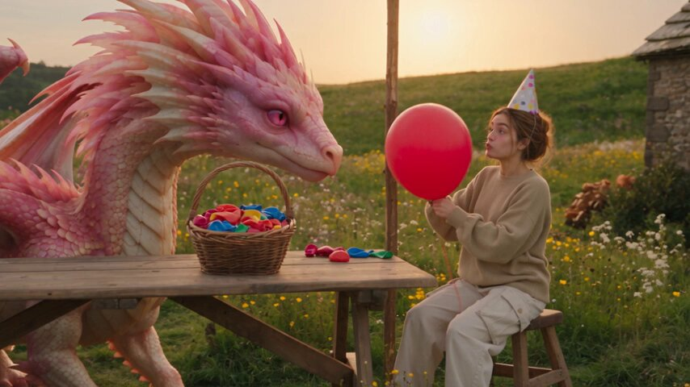

# 巨龙吹气球：Daisy 的草地生日派对，龙一口气把气球吹爆、吓得四脚朝天，最后放飞彩虹气球云的 30 秒奇幻喜剧短片

- 原帖链接：https://x.com/Alina_with_Ai/status/2126134075648032981
- 作者：Alina Ai（@Alina_with_Ai）
- 时间：2026-11-27 10:00 (UTC+8 / Asia/Taipei)
- 互动摘要：点赞 74 · 转发 6 · 回复 44 · 引用 3 · 书签 14 · 浏览 1345（采集快照：2026-11-27 20:05 UTC+8）
- 模型/工具：Seedance 2.5（作者标注）
- 标签：真人
- 媒体路径：
  - `media/video-stills/2126134075648032981_still.jpg`（视频封面截图，）
  - 视频本体未入库，仅保留原帖链接：https://x.com/Alina_with_Ai/status/2126134075648032981
- 入库日期：2026-11-27
- prompt 来源：https://x.com/Alina_with_Ai/status/2126134080135901515（作者自回复）
- 备注：prompt 在作者自回复（2126134080135901515），从「Photorealistic Hollywood fantasy comedy」起原样摘录到结尾（略去开头「Video prompt ⤵️」）。按 3 秒一段分镜，需配 Daisy 与巨龙参考图。与 2026-11-26 已收的同作者「巨龙与超大号皮靴」属同一 Daisy × 巨龙系列，换了场景与剧情；同作者今天另有溜冰篇，未重复收。视频本体未入库，仅保留原帖链接。

## prompt 原文

```text
Photorealistic Hollywood fantasy comedy, 16:9, 4K, shot on ARRI Alexa 65 with 35mm anamorphic lenses, 24fps cinematic film look, soft warm golden-hour sunlight, clean low-noise image, creamy shallow depth of field with oval anamorphic bokeh, ultra-sharp detail, natural film grain, rich warm color grade, smooth stable camera, fast comedic hard cuts. Setting stays the same in every shot: a beautiful sunny flower meadow with a long wooden party table, colorful ribbon bunting between two wooden poles, a big wicker basket full of deflated balloons in many colors, a small wooden stool, a stone cottage behind, and soft green hills. Match Daisy and giant dragon references. The dragon is the same size in every shot, about as tall as the cottage; show its full body, wings, legs and tail in wide shots. The dragon is eager, clumsy and sweet. Daisy wears her usual dress with only an added small paper party hat. The balloons are large glossy party balloons, each about as big as Daisy's torso when properly inflated, and the dragon holds them gently between two claw tips. Natural English dialogue for Daisy only, accurate lip-sync. The dragon NEVER speaks; it only makes giggles, huffs, whimpers, gulps and purrs. Only Daisy and the dragon appear: no animals, no insects, no extra characters, and nothing stuck on the dragon's face.

0-3s: Hook, slow dolly-in at eye level: Daisy sits on the stool and ties a ribbon to a limp red balloon, then holds it up to the dragon, who sits in front of her with huge sparkling eyes. "Rule number one: one tiny puff. Gently."

3-6s: Macro close-up with shallow focus: the dragon pinches the balloon's neck between two claw tips and blows one soft, tiny breath; the red balloon swells to a perfect shape. Cut to a medium shot: it looks at Daisy with huge proud eyes. She gives a thumbs-up. "Perfect!"

6-9s: Medium shot: the dragon, too excited, takes a deeper breath into a blue balloon and it grows bigger and bigger, as big as a wagon, tugging Daisy's ribbon so her feet lift an inch off the ground while she holds the end. She hangs on with both hands, her party hat tilting. "Not that much!"

9-12s: Wide static shot: the giant balloon pops with a loud "BANG", leaving a shower of shiny blue scraps. The dragon jumps in fright, flaps backward and falls onto its back on the grass with its legs in the air, eyes wide, whimpering. Daisy covers her ears, then laughs.

12-15s: Close shot: Daisy walks up and holds one of the dragon's claws, standing at its shoulder. "It's okay. It was just a balloon." The dragon sits up slowly, still trembling, and nods, then looks at the basket with a mix of fear and curiosity.

15-18s: Smooth side-tracking shot: the dragon takes a new balloon, inflates it with one tiny controlled puff, ties the ribbon with its claw tip, and hands it to Daisy. It repeats this with a pink, yellow, green and purple balloon. A rainbow of balloons floats above the table in the golden light, reflecting in its large eyes.

18-21s: Wide static shot: Daisy opens her arms, and the dragon gently releases all the balloons at once. They rise together into the sky like a colorful cloud over the meadow. Daisy and the dragon watch with their heads tilted back, mouths open in awe, the light glowing through the balloons.

21-24s: Medium shot: one last balloon drifts back down and bumps the tip of the dragon's nose, squeaking softly. The dragon crosses its eyes to look at it, giggles, and the balloon bounces gently off and floats up again. Daisy covers her mouth, laughing.

24-27s: Close shot: Daisy twists a long balloon into a tiny dragon, squeaking as she twists, and holds it up. The dragon's eyes sparkle. It receives the tiny balloon dragon on its open palm like a jewel, barely breathing so as not to pop it.

27-30s: Wide golden-sunset shot, slow dolly-out: the dragon sits in the meadow with the tiny balloon dragon on its palm, Daisy leaning against its chest, and a cloud of colorful balloons drifting far in the sky behind them. Daisy, to the camera, deadpan: "Next time... confetti." The tiny balloon dragon slowly deflates with a long "pffffffft" and zooms in circles around the dragon's head, which follows it with crossed eyes. Freeze on that. Hold this shot until the end.

Realistic balloon, rubber, ribbon and fabric physics, expressive acting, cinematic scale. No slow motion, modern objects, subtitles or watermark.
```

---

个人学习归档，非商业。prompt 与媒体版权归原作者 @Alina_with_Ai，引用请回到原帖。
