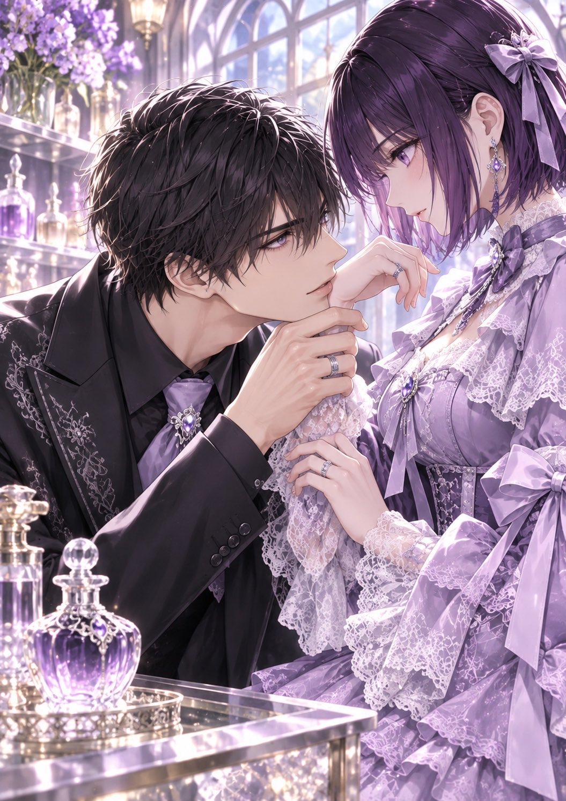

# 「君に贈る、秘密の香り。」：上传两位角色图，在薰衣草色古董香水店里执手闻香、视线交汇（结构化 2D〜2.5D 动画调 prompt）

- 原帖链接：https://x.com/_luna000_m/status/2126151777028395386
- 作者：🌙 月城 美桜 🌸宵🖤AI創作（@_luna000_m）
- 时间：2026-11-27 11:11 (UTC+8 / Asia/Taipei)
- 互动摘要：点赞 26 · 转发 4 · 回复 0 · 引用 0 · 书签 12 · 浏览 602（采集快照：2026-11-27 20:05 UTC+8）
- 模型/工具：未注明
- 标签：二次元
- 媒体路径：
  - `media/images/2126151777028395386_1.jpg`（）
- 入库日期：2026-11-27
- 备注：prompt 在主帖图片 ALT 里，整段原样摘录。作者标注「🪻 プロンプト配布 🪻」「画像のALTからご自由にどうぞ」。prompt 开头明确要求「成人の二人を描いてください」，示例为西装 + 古典洛丽塔礼服、腰上构图，非性化。同作者另有「静寂の書庫、秘密の口づけ」壁咚 prompt 帖，按每轮同作者一条的惯例留待下轮。

## prompt 原文

```text
添付されたキャラクター参照画像を最優先し、成人の二人を描いてください。性別・髪型・髪色・瞳・体格・身長差・関係性・衣装は変更可能。

【構図・ポーズ】
上品な香水専門店で、片方が相手の手を優しく支え、手首に顔を寄せて香りを確かめる。香りを楽しむ途中でふと視線を上げ、互いの瞳が重なる瞬間。腰上からの斜め側面構図。

【衣装】
黒のエレガントなスーツと淡紫のネクタイ、ラベンダー色のクラシカルロリータ。繊細な白いレース、銀刺繍、リボン、宝石装飾。衣装や配色はキャラクターに合わせて変更可能。

【背景・照明】
白とラベンダーを基調としたアンティークな香水専門店。透明なガラス棚、銀細工のクリスタル香水瓶、紫色の花々、大きなアーチ窓。柔らかな午後の陽光がガラスを透過し、淡い虹色の輝きを生み出す。

【表情・雰囲気】
手首に顔を寄せながら、愛情を込めた眼差しで相手を見つめる。相手は僅かに頬を染め、優しく見つめ返す。上品な色気、気品、透明感、穏やかな親密さを表現する。

【仕上げ】
A4縦、カラー、高品質2D〜2.5Dアニメ調。繊細な髪、美しい瞳、精密なレース、香水瓶の透明感と光の屈折。背景は柔らかくぼかし、二人の表情と手元を際立たせる。
参照画像の顔立ちと個性を厳守。自然な人体構造、正確な手指と関節。身体の貫通・欠損・増殖・別人化を禁止。文字・ロゴ・透かしなし。
```

---

个人学习归档，非商业。prompt 与媒体版权归原作者 @_luna000_m，引用请回到原帖。
