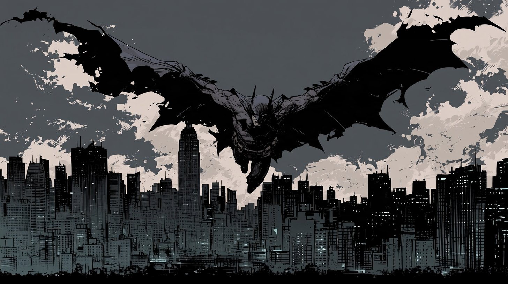
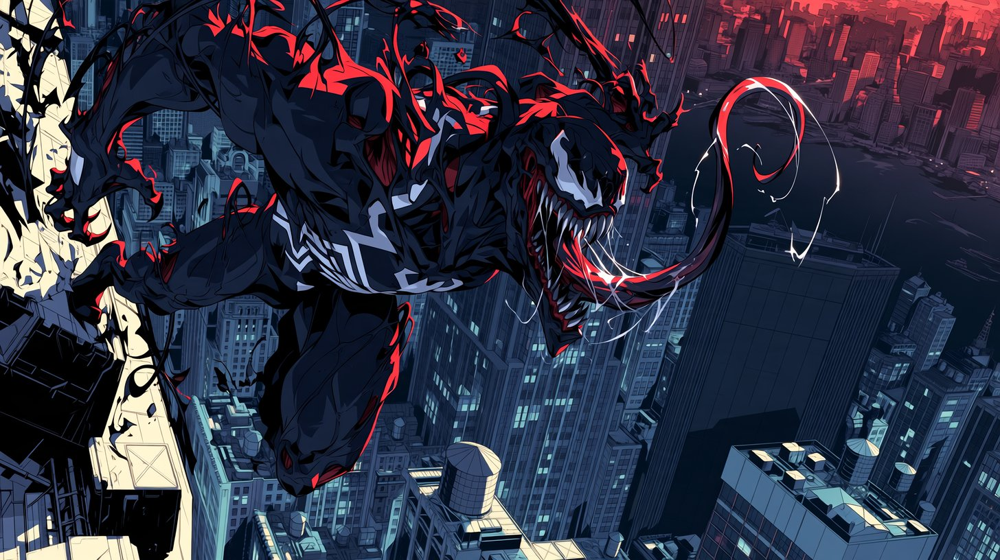
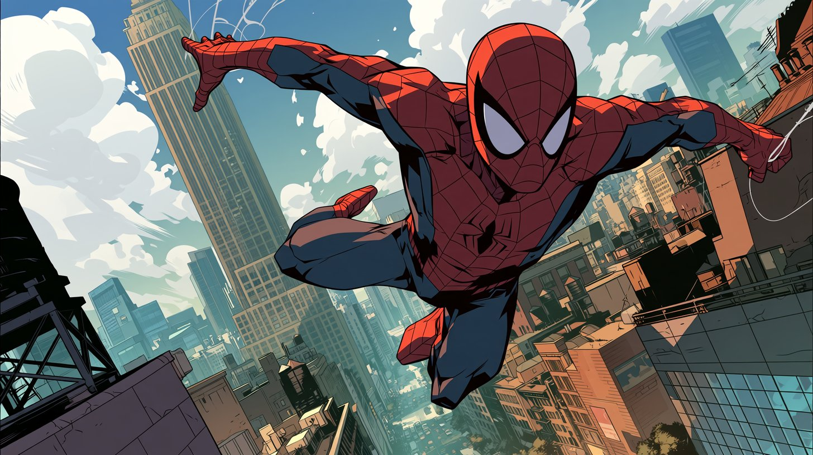
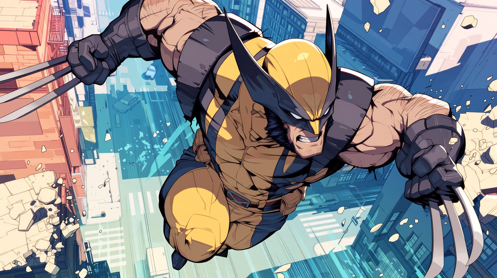

# Niji 8 动漫风超级英雄四连：蝙蝠侠 / 毒液 / 蜘蛛侠 / 金刚狼飞跃城市天际线（Ryan Ottley 风 + 粗野主义锐角构图）

- 原帖链接：https://x.com/Artedeingenio/status/2126240388109242459
- 作者：OscarAI（@Artedeingenio）
- 时间：2026-11-27 17:03 (UTC+8 / Asia/Taipei)
- 互动摘要：点赞 20 · 转发 1 · 回复 2 · 引用 0 · 书签 9 · 浏览 1098（采集快照：2026-11-27 20:05 UTC+8）
- 模型/工具：Midjourney Niji 8（prompt 含 --niji 8）
- 标签：二次元
- 媒体路径：
  - `media/images/2126240388109242459_1.jpg`（）
  - `media/images/2126240388109242459_2.jpg`（）
  - `media/images/2126240388109242459_3.jpg`（）
  - `media/images/2126240388109242459_4.jpg`（）
- 入库日期：2026-11-27
- 备注：4 张图各有一段 prompt，均在图片 ALT 里，按图序原样摘录（[图N] 为本仓库加的序号）。四段只换角色名、动作与配色，其余风格词相同，可当模板。角色为 DC / Marvel 版权角色，属同人/二创。同作者今天另有 Jinx 读龙珠的 Niji 8 帖，按每轮同作者一条的惯例未收。

## prompt 原文

```text
[图1] Batman flying over a city skyline, in the style of anime aesthetic, Ryan Ottley, Robert Kirkman, dark black and grey, dc comics, superheroes, cartoon violence, brutalist, rtx, sharp angles --ar 16:9 --niji 8

[图2] Venom flying over a city skyline, in the style of anime aesthetic, Ryan Ottley, Robert Kirkman, dark black and red, dc comics, superheroes, cartoon violence, brutalist, rtx, sharp angles --ar 16:9 --niji 8

[图3] Spiderman flying over a city skyline, in the style of anime aesthetic, Ryan Ottley, Robert Kirkman, light red and blue, dc comics, superheroes, cartoon violence, brutalist, rtx, sharp angles --ar 16:9 --niji 8

[图4] Wolverine in action pose in the city, in the style of anime aesthetic, Ryan Ottley, Robert Kirkman, light yellow light blue and black, dc comics, superheroes, cartoon violence, brutalist, rtx, sharp angles --ar 16:9 --niji 8
```

---

个人学习归档，非商业。prompt 与媒体版权归原作者 @Artedeingenio，引用请回到原帖。
